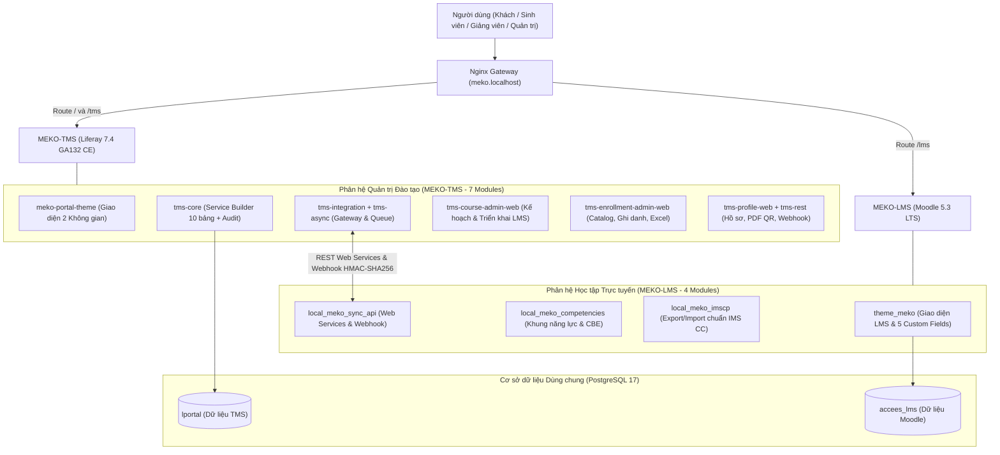
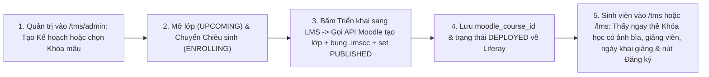
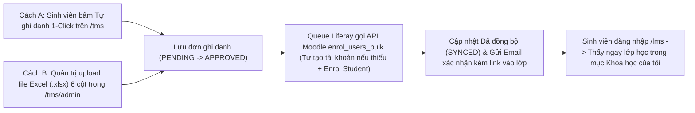
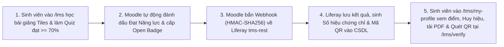

# KIẾN TRÚC TỔNG THỂ, DANH MỤC MODULE & LUỒNG NGHIỆP VỤ (`MEKO-DLE`)

Trang tổng quan giúp toàn bộ Team nắm ngay trong 3 phút: **Hệ thống gồm những phân hệ nào, mỗi bên có bao nhiêu Module, ai dùng gì, và dữ liệu chạy ra sao từ lúc Quản trị thao tác đến lúc Sinh viên nhìn thấy.**

---

## 1. Kiến trúc Tổng thể 2 Phân hệ (`MEKO-TMS` ↔ `MEKO-LMS`)

---

## 2. Thống kê Toàn bộ Module của 2 Phân hệ & Vai trò Sử dụng

### 2.1. Bên `MEKO-LMS` (Moodle 5.3 LTS) — **4 Module Cốt lõi**

| STT | Tên Module (`meko-lms/`) | Vai trò sử dụng | Chức năng chính |
| :---: | :--- | :--- | :--- |
| **1** | **`theme_meko`** | Khách, Sinh viên, Giảng viên | Giao diện Trang chủ, Catalog, Khóa học của tôi, Trang đăng nhập; đọc 5 Course Custom Fields & ảnh bìa thật từ DB. |
| **2** | **`local_meko_competencies`** | Giảng viên, Sinh viên, Admin | Nạp & hiển thị 2 Khung năng lực số (DigComp 2.2 & DigCompEdu), gắn chuẩn đầu ra vào khóa học & Quiz. |
| **3** | **`local_meko_imscp`** | Giảng viên, Quản trị / TMS | Xuất khóa học Moodle ra gói chuẩn mở `.imscc` (IMS CC + QTI + LOM) và nhận lệnh API tạo khóa học từ gói `.imscc`. |
| **4** | **`local_meko_sync_api`** | Hệ thống TMS (API & Webhook) | Cung cấp REST API đồng bộ khóa học, ghi danh hàng loạt (`enrol_users_bulk`), lấy kết quả/huy hiệu & bắn Webhook `HMAC-SHA256`. |

### 2.2. Bên `MEKO-TMS` (Liferay 7.4 GA132 CE) — **7 Module Cốt lõi**

| STT | Tên Module (`meko-tms/`) | Không gian & Vai trò | Chức năng chính |
| :---: | :--- | :--- | :--- |
| **1** | **`meko-portal-theme`** | Toàn bộ Portal (2 Không gian) | Giao diện chuẩn đồng bộ LMS: Menu ngang cho Khách/Học viên (`/tms`), Header + Left Sidebar cho Quản trị (`/tms/admin`). |
| **2** | **`tms-core`** (`api` + `service`) | Tầng dữ liệu nội bộ | Service Builder 10 bảng đầy đủ Audit trên Postgres 17: Kế hoạch, Lớp, Khung năng lực, Học viên, Ghi danh, Chứng chỉ QR, Sync Log, Email Template & Email Log. |
| **3** | **`tms-integration`** + **`tms-async`** | Tầng tích hợp & chạy nền | Điều phối qua 2 lib adapter (`MoodleRestClient` & `IdentityProvisioningService` — hiện tại tạo trực tiếp user Liferay + Moodle `auth=manual`, sau này bật SSO đổi config sang `KeycloakAdminClient` + `auth=oidc`), LMB Queue & Email `.ftl`. |
| **4** | **`tms-course-admin-web`** | Không gian Quản trị (Cán bộ ĐT) | Lập kế hoạch mở lớp, chuyển trạng thái chiêu sinh, bấm **Triển khai sang Moodle** tạo lớp tự động. |
| **5** | **`tms-enrollment-admin-web`** | Cả 2 Không gian (HV & Cán bộ) | Trang Catalog & Tự ghi danh 1-Click cho học viên; Bảng xét duyệt ghi danh & Import danh sách Excel `.xlsx` cho Cán bộ. |
| **6** | **`tms-profile-web`** | Không gian Học viên + Công khai | Hồ sơ học tập cá nhân (`/tms/my-profile`: điểm, huy hiệu, tải chứng chỉ PDF QR) & Trang xác thực QR công khai (`/tms/verify`). |
| **7** | **`tms-rest`** | Tích hợp hệ thống | Tiếp nhận Webhook từ Moodle khi học viên đạt Huy hiệu (`POST /o/meko-tms/api/webhooks/badge-awarded`) & API tra cứu chứng chỉ. |

---

## 3. 3 Luồng Nghiệp vụ Thực tế ("Quản trị làm gì → Hệ thống đồng bộ gì → Sinh viên thấy gì")

### Flow 1: Quản trị Tạo/Mở lớp & Công bố → Sinh viên thấy trên Catalog

- **Quản trị thấy & làm:** Vào menu trái **Quản lý Khóa học** (`08`), tạo lớp `MK-2026-01`, chọn giảng viên, ngày khai giảng, gói học liệu `.imscc`, rồi bấm **Triển khai LMS**.
- **Hệ thống chạy ngầm:** Liferay gọi `local_meko_imscp_create_course` sang Moodle tạo khóa học thật với `visible = 1` và Custom Field `accees_course_status = PUBLISHED`.
- **Sinh viên thấy:** Mở `/tms` (`07`) hoặc `/lms` (`01`, `02`) thấy ngay thẻ khóa học có ảnh bìa thật, tên giảng viên, thời lượng, sĩ số `28/50` và nút **Đăng ký ngay**.

### Flow 2: Ghi danh Học viên (Tự đăng ký hoặc Admin Import Excel) → Vào học trên LMS

- **Quản trị thấy & làm:** Vào **Xét duyệt Ghi danh** (`09`), bấm duyệt đơn tự ghi danh hoặc upload file Excel danh sách 20 học viên.
- **Sinh viên thấy:** Nhận email thông báo có nút **Vào học ngay**, vào `/lms/my/courses.php` (`03`) thấy khóa học và vào học giao diện Tiles (`05`).

### Flow 3: Sinh viên Học & Thi Quiz → Tự động Cấp Huy hiệu & Chứng chỉ QR

- **Sinh viên thấy:** Trong **Hồ sơ Học tập** (`10`), thấy điểm số `8.5/10`, tiến độ khung năng lực `100%`, Huy hiệu số và nút tải **Chứng chỉ PDF có mã QR**. Ai quét mã QR vào `/tms/verify` (`15`) đều kiểm tra được chứng chỉ hợp lệ.
- **Quản trị thấy:** Theo dõi tỷ lệ hoàn thành & danh sách chứng chỉ đã cấp ngay trên trang quản trị `/tms/admin`.
