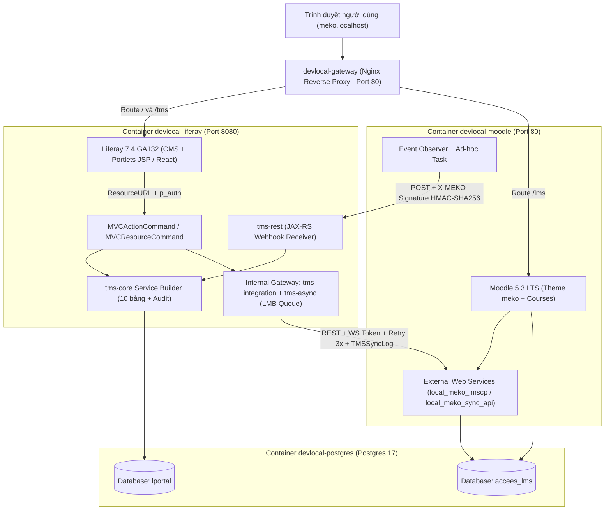
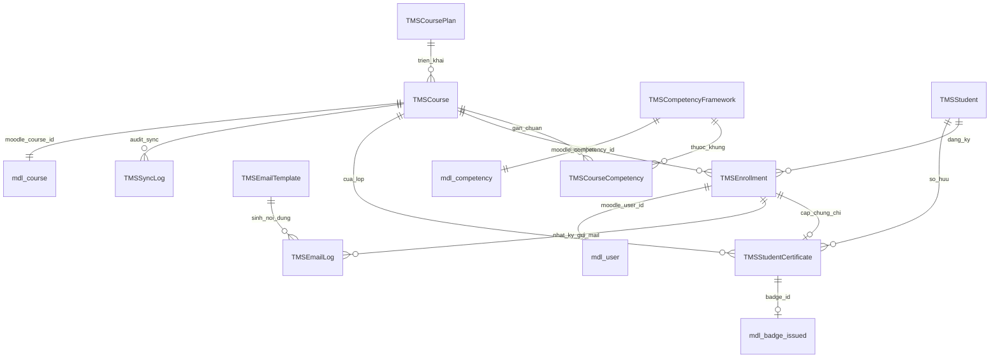
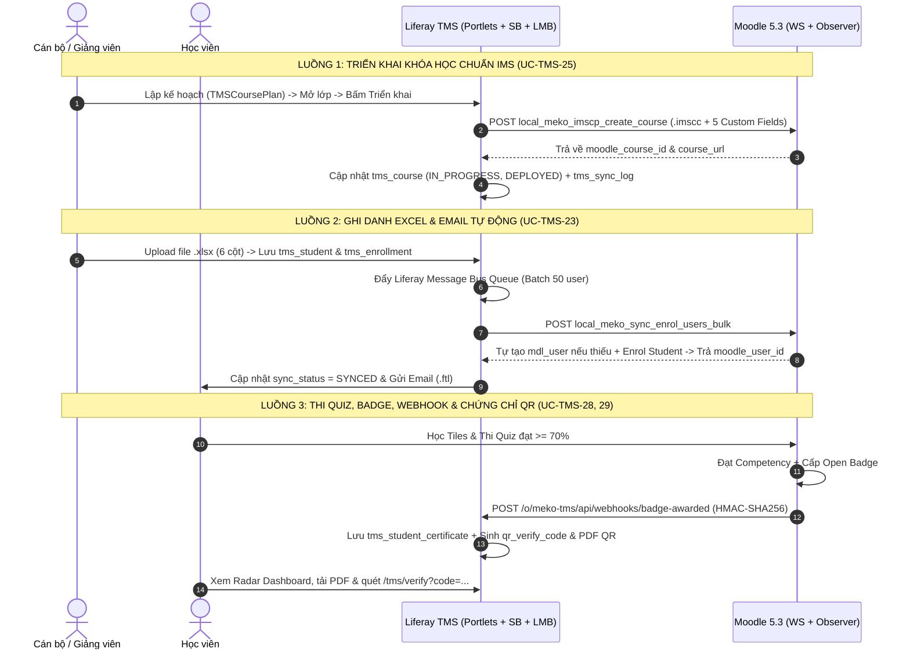

# LUỒNG ĐỒNG BỘ DỮ LIỆU THẬT, BIỂU MẪU, SERVICE BUILDER & API CONTRACTS

Tài liệu này trả lời đầy đủ 3 câu hỏi cốt lõi cho Dev:
1. **Hai hệ thống đồng bộ trực tiếp hay qua API Gateway?**
2. **Dữ liệu bên Moodle và Liferay ánh xạ từng trường, từng trạng thái như thế nào?**
3. **Cấu trúc `service.xml` (10 bảng Postgres 17 có đủ Audit), các Biểu mẫu (`.xlsx`, 2 mẫu Email `.ftl`, `.imscc`) & API JSON Contracts ra sao?**

---

## 1. Kiến trúc Đồng bộ giữa Liferay TMS & Moodle LMS (Gateway Pattern)



**Quyết định kiến trúc thực tế:**
- **Không để trình duyệt/React gọi thẳng sang Moodle** (lộ Token) và **không cần dựng thêm cụm Kong/Kafka microservice rời** trên `devlocal` làm nặng máy dev.
- Dùng **Nginx Gateway (`devlocal-gateway`) ở lớp mạng ngoài** kết hợp **Integration Gateway nội bộ trong Liferay (`tms-integration` + `tms-async` + `tms_sync_log`)**: giấu Token, Retry tự động 3 lần, ghi Audit Log và **sẵn sàng cắm API Gateway rời khi scale Production** chỉ bằng cách đổi URL trong OSGi Configuration.

---

## 1.1. Sơ đồ ERD 10 Thực thể Service Builder (`MEKO_TMS`) & Liên kết Moodle



---

## 1.2. Sơ đồ Tuần tự (Sequence) 3 Luồng Tích hợp Cốt lõi TMS ↔ LMS



---

## 2. Ánh xạ Trạng thái & Dữ liệu Thật giữa Moodle và Liferay

### 2.1. Bảng Quy đổi Trạng thái Khóa học (Status Lifecycle Mapping)

| Giai đoạn nghiệp vụ | Trạng thái trên Liferay (`tms_course.status`) | Trạng thái đồng bộ (`moodle_sync_status`) | Trạng thái tương ứng trên Moodle (`mdl_course.visible` + Custom Field `accees_course_status`) |
| :--- | :--- | :--- | :--- |
| **1. Đang lập kế hoạch** | `tms_course_plan.status = DRAFT_PLAN / PENDING_APPROVAL` | *(Chưa tạo lớp)* | Chưa tạo khóa học trên Moodle (hoặc đang biên soạn riêng ở Moodle ở trạng thái `DRAFT`, `visible = 0`). |
| **2. Đã duyệt mở lớp (Sắp mở)** | `tms_course.status = UPCOMING` | `NOT_DEPLOYED` *(hoặc đã map sẵn)* | Nếu đã có bên Moodle thì vẫn giữ `visible = 0` (`UNDER_REVIEW`). |
| **3. Đang mở chiêu sinh** | `tms_course.status = ENROLLING` | `NOT_DEPLOYED` hoặc `DEPLOYED` | Nếu đã bung lớp sẵn thì có thể ở trạng thái sẵn sàng chờ khai giảng; học viên chưa vào học cho tới khi được duyệt. |
| **4. Đang triển khai (Khả dụng)** | `tms_course.status = IN_PROGRESS` | **`DEPLOYED`** | **`visible = 1`** VÀ **`customfield[accees_course_status] = PUBLISHED`** *(Đây là điều kiện bắt buộc để API `get_courses` trả khóa học khả dụng về TMS Catalog).* |
| **5. Đã kết thúc / Đóng** | `tms_course.status = FINISHED / ARCHIVED` | `DEPLOYED` | **`visible = 0`** VÀ **`customfield[accees_course_status] = CLOSED`**. |

---

### 2.2. Luồng A: Lấy Danh sách Khóa học từ Moodle sang Liferay (`local_meko_sync_get_courses`)

**Điều kiện lọc mặc định khi TMS kéo về Catalog:** `mdl_course.visible = 1` AND `accees_course_status = 'PUBLISHED'`.

| Nguồn bên Moodle (Bảng / API) | Trường dữ liệu Moodle | Lưu vào Liferay (Bảng & Cột Service Builder) | Kiểu & Ghi chú |
| :--- | :--- | :--- | :--- |
| `mdl_course` | `id` | `tms_course.moodle_course_id` | `long` (Khóa liên kết 2 hệ thống) |
| `mdl_course` | `shortname` | `tms_course.moodle_shortname` & `course_code` | `String` (VD: `NLS-01-IMS`) |
| `mdl_course` | `fullname` | `tms_course.course_title` | `String` |
| `mdl_course` | `summary` | `tms_course_plan.course_description` | `TEXT` (Làm sạch HTML hoặc giữ mô tả) |
| `mdl_course` | `startdate` / `enddate` | `tms_course.start_date` / `end_date` | Chuyển đổi Unix Epoch → `Date` |
| `mdl_course_categories` | `id`, `idnumber`, `name` | Metadata danh mục / `lom_payload_json` | `String` |
| File Storage (`course/overviewfiles`) | `course_image_url` | `tms_course.thumbnail_url` | URL ảnh bìa 16:9 thật |
| **Custom Field 1** | `accees_course_status` (`DRAFT`/`UNDER_REVIEW`/`PUBLISHED`/`CLOSED`) | Quyết định map `tms_course.status` | Đọc qua `\core_course\customfield\course_handler` |
| **Custom Field 2** | `accees_delivery_mode` (`Online`/`Blended`/`Self-paced`) | `tms_course_plan.delivery_format` | `String` |
| **Custom Field 3** | `accees_duration` (VD: `3 Credits · 60 Hours`) | `tms_course_plan.credit_hours` + nhãn hiển thị | `int` / `String` |
| **Custom Field 4** | `accees_institution` (VD: `Mekosoft Training Hub`) | `tms_course_plan.lom_payload_json` / metadata đơn vị | `String` |
| **Custom Field 5** | `accees_is_featured` (`0` / `1`) | Cờ hiển thị nổi bật trên Trang chủ TMS | `boolean` |
| `get_course_contacts` (`editingteacher`) | `fullname`, `email` | `tms_course_plan.lecturer_name`, `lecturer_email` | Giảng viên phụ trách thật |
| `mdl_competency_coursecomp` + `mdl_competency` | `competency.id`, `idnumber`, `shortname`, `framework.idnumber` | `tms_competency_framework` + `tms_course_competency` | Chuẩn đầu ra của khóa học |
| `mdl_grade_items` (`itemmodule='quiz'`) | `gradepass` (VD: `7.0`) | `tms_competency_framework.min_pass_score` | Ngưỡng điểm đạt năng lực |

---

### 2.3. Luồng B: Lập Kế hoạch & Triển khai Khóa học từ Liferay sang Moodle (`UC-TMS-17, 18, 19, 25`)

1. Cán bộ lập kế hoạch trên Liferay lưu vào **`tms_course_plan`** (`lom_identifier`, `ims_package_url`, `course_title`, `course_description`, `delivery_format`, `credit_hours`, `estimated_learners`, `expected_start_date`, `expected_end_date`, `lecturer_name`, `lecturer_email`, `lom_payload_json`).
2. Duyệt kế hoạch (`APPROVED`) → Tạo lớp thực tế trong **`tms_course`** (`status = UPCOMING`) → Mở chiêu sinh (`ENROLLING`).
3. Khi bấm nút **"Triển khai sang Moodle"**:
   - Liferay đặt `tms_course.moodle_sync_status = DEPLOYING`.
   - `MoodleRestClient` gọi **`local_meko_imscp_create_course`** gửi sang Moodle: `{ course_code, course_title, category_idnumber, start_date, end_date, ims_package_url (hoặc imscc_base64), customfields: {accees_course_status: "PUBLISHED", ...}, lecturer_email, competency_idnumbers[] }`.
   - Moodle giải nén `.imscc` (`imsmanifest.xml`), tạo khóa học, tạo 4 Sections/Tiles, Page, Resource, Quiz (từ QTI XML), gắn 5 Custom Fields, gắn Competency, enrol Giảng viên → trả về `{ moodle_course_id, shortname, course_url }`.
   - Liferay cập nhật `tms_course.moodle_course_id`, `moodle_sync_status = DEPLOYED`, `status = IN_PROGRESS` và ghi log vào `tms_sync_log`.

---

### 2.4. Luồng C: Ghi danh, Import Excel & Điều phối Tạo Tài khoản (Hỗ trợ Chưa có SSO → Sẵn sàng Bật SSO sau)

1. **Biểu mẫu Excel Import Học viên chuẩn (`.xlsx`):**
   Cán bộ tải file mẫu từ Portlet `tms-enrollment-admin-web`, bắt buộc đúng 6 cột dòng header:

   | `STT` | `student_code` | `full_name` | `email` | `phone` | `organization` |
   | :---: | :--- | :--- | :--- | :--- | :--- |
   | `1` | `MK2026001` | `Nguyễn Văn An` | `an.nguyen@mekosoft.vn` | `0901234567` | `Phòng Kỹ thuật Phần mềm` |

2. **Lưu trên Liferay:**
   - Parse từng dòng bằng Apache POI → Upsert vào **`tms_student`** (khóa duy nhất `student_code`, `email`).
   - Tạo bản ghi trong **`tms_enrollment`** (`course_id`, `student_id`, `enrollment_type = EXCEL_IMPORT` / `SELF_ENROLL` / `DIRECT_ADMIN`, `status = APPROVED`, `sync_status = PENDING`).
   - Đẩy vào **Liferay Message Bus Queue (`tms-async`)**.
3. **Điều phối qua 2 Lib Adapter (`IdentityProvisioningService` + `MoodleRestClient`):**
   - Trong `tms-integration` tách sẵn 2 lớp điều phối độc lập theo biến OSGi Config `authMode` (`LOCAL_DIRECT` | `KEYCLOAK_SSO`):
     - **Bước 3a — Qua SSO Lib (`IdentityProvisioningService`):**
       - *Hiện tại (`LOCAL_DIRECT` — chưa có SSO):* Kiểm tra `UserLocalService.fetchUserByEmailAddress(...)` trên Liferay; nếu chưa có thì tạo trực tiếp User Liferay nội bộ để học viên đăng nhập được `/tms` xem hồ sơ (`sso_user_id = LOCAL`).
       - *Sau này khi bật SSO (`KEYCLOAK_SSO`):* Chỉ đổi config sang `KeycloakAdminClient` → check & tạo user trên Keycloak/OpenLDAP, lưu `sso_user_id` về `tms_student` mà **không sửa Portlet/SB**.
     - **Bước 3b — Qua Moodle Lib (`MoodleRestClient` → `local_meko_sync_enrol_users_bulk`):**
       - Gửi batch tối đa 50 học viên/lần kèm `auth_type` (`manual` ở chế độ hiện tại, `oidc` khi bật SSO).
       - Moodle kiểm tra `mdl_user` theo `email`/`username`: chưa có thì **tạo trực tiếp user bên Moodle** (nếu `manual` thì sinh mật khẩu tạm trả/gửi qua email), sau đó Enrol `roleid = 5` (Student) vào khóa học.
       - *(Khi nâng cấp từ `manual` lên `oidc` sau này: chạy 1 lệnh chuyển `mdl_user.auth = 'oidc'` theo `email` là giữ nguyên 100% lịch sử học tập).*
   - Moodle trả về `moodle_user_id` cho từng dòng → Liferay cập nhật `tms_student.moodle_user_id`, `tms_enrollment.moodle_user_id`, `sync_status = SYNCED`.
4. **Kiến trúc Email, Nhật ký `TMSEmailLog` & 2 Biểu mẫu Xét duyệt (`ENROLLMENT_APPROVED` vs `ENROLLMENT_REJECTED`):**
   - **Tận dụng sẵn của Liferay hay tự viết?** Kết hợp **đúng chỗ tốt nhất của cả 2**:
     - **Tầng gửi SMTP dùng sẵn của Liferay (`MailServiceUtil.sendEmail(MailMessage)`):** Không tự code `javax.mail` Session; Liferay tự đọc cấu hình SMTP từ `portal-ext.properties` (DevLocal trỏ vào **Mailpit `devlocal-mailpit:1025`** xem tại `http://meko.localhost/mail`, Production chỉ đổi SMTP Server trong Control Panel).
     - **Mẫu HTML/FreeMarker dùng mẫu của mình (`TMSEmailTemplate` + `.ftl` dự phòng):** KHÔNG dùng Notification template mặc định của Liferay vì mẫu Liferay thiếu biến nghiệp vụ (mã lớp, link Moodle Tiles, mật khẩu tạm `LOCAL_DIRECT`, lý do từ chối) và không khớp brand `#0B1C61`/`#0000B6`.
     - **Nhật ký gửi Email dùng bảng riêng `TMSEmailLog` (`tms_email_log`):** Tách khỏi `TMSEnrollment` vì một đơn có thể nhận **nhiều lần gửi** (Từ chối / Chấp nhận / Admin bấm **"Gửi lại Email"** / Cấp chứng chỉ), giúp lưu snapshot `renderedBodyHtml`, trạng thái `QUEUED | SENT | FAILED`, `errorMessage`, `sentDate` và người kích hoạt (`userId`, `userName`).
   - **2 Mẫu Email Ghi danh Bắt buộc (kèm mẫu `CERTIFICATE_ISSUED` ở Flow D):**
     1. **`ENROLLMENT_APPROVED`** (`email_enrollment_approved.ftl` — Xem mockup `11_email_enrollment_notification.html`): Gửi ngay khi `sync_status = SYNCED` (Duyệt đơn tự đăng ký hoặc Import Excel thành công). Biến bắt buộc: `${studentName}`, `${courseCode}`, `${courseTitle}`, `${startDate}`, `${username}`, `${tempPasswordInfo}`, `${directCourseUrl}`.
     2. **`ENROLLMENT_REJECTED`** (`email_enrollment_rejected.ftl` — Xem mockup `12_email_enrollment_rejected.html`): Gửi ngay khi Cán bộ bấm **Từ chối** đơn tự đăng ký (`status = REJECTED`). Biến bắt buộc: `${studentName}`, `${enrollmentCode}`, `${courseCode}`, `${courseTitle}`, `${startDate}`, `${rejectReason}` *(lấy từ `approvalNotes`)*, `${catalogUrl}`.

   **Mẫu 1 — Chấp nhận Ghi danh (`email_enrollment_approved.ftl` — Solid `#0B1C61` / `#0000B6`, 0% Emoji):**
   ```html
   <div style="font-family: 'Be Vietnam Pro', Arial, sans-serif; max-width: 640px; margin: 0 auto; border: 1px solid #E5E7EB; border-radius: 8px; overflow: hidden; background: #FFFFFF;">
     <div style="background: #FFFFFF; padding: 18px 24px; border-bottom: 3px solid #0000B6;">
       <strong style="font-size: 18px; color: #0000B6;">MEKOSOFT</strong>
       <span style="font-size: 12px; color: #4B5563; float: right;">MEKO-DLE TRAINING PORTAL</span>
     </div>
     <div style="background: #0B1C61; color: #FFFFFF; padding: 24px; text-align: center;">
       <h2 style="margin: 0; font-size: 20px; font-weight: 800;">XÁC NHẬN GHI DANH THÀNH CÔNG</h2>
       <p style="margin: 6px 0 0 0; font-size: 13px; color: #CBD5E1;">Tài khoản học tập của bạn đã được kích hoạt trên MEKO-LMS</p>
     </div>
     <div style="padding: 24px; color: #1F2937; line-height: 1.6; font-size: 14px;">
       <p>Kính gửi Học viên <strong>${studentName}</strong>,</p>
       <p>Yêu cầu ghi danh của bạn đã được phê duyệt. Thông tin lớp học:</p>
       <table style="width: 100%; border-collapse: collapse; background: #F8FAFC; border: 1px solid #E2E8F0; margin: 14px 0;">
         <tr><td style="padding: 8px 12px; color: #4B5563; width: 150px;">Khóa học:</td><td style="padding: 8px 12px; font-weight: 700;">${courseTitle} (${courseCode})</td></tr>
         <tr><td style="padding: 8px 12px; color: #4B5563;">Khai giảng:</td><td style="padding: 8px 12px;">${startDate}</td></tr>
         <tr><td style="padding: 8px 12px; color: #4B5563;">Tên đăng nhập:</td><td style="padding: 8px 12px; font-family: monospace;">${username}</td></tr>
         <tr><td style="padding: 8px 12px; color: #4B5563;">Thông tin mật khẩu:</td><td style="padding: 8px 12px;">${tempPasswordInfo}</td></tr>
       </table>
       <div style="text-align: center; margin: 22px 0;">
         <a href="${directCourseUrl}" style="display: inline-block; background: #0000B6; color: #FFFFFF; padding: 12px 28px; border-radius: 6px; text-decoration: none; font-weight: 700;">VÀO HỌC NGAY</a>
       </div>
       <p style="font-size: 12.5px; color: #64748B;">Hỗ trợ kỹ thuật: support@mekosoft.vn</p>
     </div>
   </div>
   ```

   **Mẫu 2 — Không chấp nhận / Từ chối Ghi danh (`email_enrollment_rejected.ftl` — Solid `#EA6400`, 0% Emoji):**
   ```html
   <div style="font-family: 'Be Vietnam Pro', Arial, sans-serif; max-width: 640px; margin: 0 auto; border: 1px solid #E5E7EB; border-radius: 8px; overflow: hidden; background: #FFFFFF;">
     <div style="background: #FFFFFF; padding: 18px 24px; border-bottom: 3px solid #0000B6;">
       <strong style="font-size: 18px; color: #0000B6;">MEKOSOFT</strong>
       <span style="font-size: 12px; color: #4B5563; float: right;">MEKO-DLE TRAINING PORTAL</span>
     </div>
     <div style="background: #EA6400; color: #FFFFFF; padding: 24px; text-align: center;">
       <h2 style="margin: 0; font-size: 20px; font-weight: 800;">THÔNG BÁO KẾT QUẢ XÉT DUYỆT GHI DANH</h2>
       <p style="margin: 6px 0 0 0; font-size: 13px; color: #FFF7ED;">Yêu cầu đăng ký lớp học của bạn chưa được chấp nhận trong đợt này</p>
     </div>
     <div style="padding: 24px; color: #1F2937; line-height: 1.6; font-size: 14px;">
       <p>Kính gửi Học viên <strong>${studentName}</strong>,</p>
       <p>Cán bộ Đào tạo đã xem xét đơn <strong>${enrollmentCode}</strong> cho khóa <strong>${courseTitle} (${courseCode})</strong> khai giảng <strong>${startDate}</strong>:</p>
       <div style="border-left: 4px solid #DC2626; background: #FEF2F2; padding: 12px 16px; color: #7F1D1D; margin: 14px 0;">
         <strong>Lý do từ chối:</strong> ${rejectReason}
       </div>
       <div style="text-align: center; margin: 20px 0;">
         <a href="${catalogUrl}" style="display: inline-block; background: #0000B6; color: #FFFFFF; padding: 11px 24px; border-radius: 6px; text-decoration: none; font-weight: 700;">XEM CÁC LỚP ĐANG MỞ KHÁC</a>
       </div>
       <p style="font-size: 12.5px; color: #64748B;">Liên hệ hỗ trợ: daotao@mekosoft.vn</p>
     </div>
   </div>
   ```

---

### 2.5. Luồng D: Kết quả Học tập, Badges & Chứng chỉ QR (`UC-TMS-28, 29`)

1. **Cơ chế kép (Real-time Webhook + Scheduler đối soát):**
   - Khi học viên thi Quiz đạt `>= 70%` trên Moodle → Moodle tự động đánh dấu đạt Competency (`mdl_competency_usercomp`) và cấp Open Badge (`mdl_badge_issued`).
   - Event Observer trên Moodle đẩy Ad-hoc Task gọi Webhook `POST /o/meko-tms/api/webhooks/badge-awarded` (kèm chữ ký `X-MEKO-Signature: sha256=<hmac>`).
   - Song song, Liferay Scheduler chạy định kỳ gọi `local_meko_sync_get_learner_results` để không bao giờ sót dữ liệu nếu Webhook lỗi mạng tạm thời.
2. **Dữ liệu lưu về Liferay (`tms_student_certificate`):**
   - `final_grade` (điểm Quiz), `completion_status` (`PASSED` / `DISTINCTION`), `badge_id`, `badge_name`, `badge_image_url`.
   - Liferay sinh `cert_serial_code` (VD: `MEKO-2026-00018`), `qr_verify_code` (SHA-256 ngắn duy nhất), `qr_verify_url` (`http://meko.localhost/tms/verify?code=...`), xuất file PDF nhúng QR Code lưu vào Liferay Document Library (`cert_pdf_file_entry_id`).

---

### 2.6. Đặc tả 4 Biểu mẫu Form Nhập liệu (Field-by-Field) & Ma trận 9 Action

Xem giao diện trực quan tại Mockup **`13_liferay_tms_course_plan_form.html`** và **`14_liferay_tms_import_reject_logs.html`**.

#### Form 1: Tạo / Sửa Kế hoạch Mở khóa (`TMSCoursePlan` — `/tms/admin`)

| STT | Ô nhập trên Form UI | Cột Service Builder (`tms_course_plan`) | Kiểu | Bắt buộc | Nguồn dữ liệu / Rule Validate |
| :---: | :--- | :--- | :---: | :---: | :--- |
| 1 | **Tên khóa học dự kiến** | `courseTitle` | `String(255)` | Có | Tối thiểu 5 ký tự, không để trống |
| 2 | **Mã LOM / Học liệu** | `lomIdentifier` | `String(100)` | Không | VD: `LOM-MK-2026-01`; hỗ trợ chọn/sinh tự động |
| 3 | **Gói `.imscc` (URL hoặc Upload)** | `imsPackageUrl` | `String(500)` | Có | Upload lên Liferay DL (`/documents/.../*.imscc`) hoặc dán URL file `.imscc` hợp lệ |
| 4 | **Hình thức đào tạo** | `deliveryFormat` | `Select` | Có | `Online` / `Blended Learning` / `Self-paced` |
| 5 | **Đối tượng học viên** | `targetAudience` | `String(255)` | Không | VD: `Sinh viên` / `Giảng viên` / `Nhân sự Kỹ thuật` |
| 6 | **Số tín chỉ / Giờ học** | `creditHours` | `int` | Có | Số nguyên `>= 1` |
| 7 | **Sĩ số dự kiến** | `estimatedLearners` | `int` | Có | Số nguyên `>= 5` và `<= 500` |
| 8 | **Ngày dự kiến mở / kết thúc** | `expectedStartDate`, `expectedEndDate` | `Date` | Có | `expectedEndDate > expectedStartDate` |
| 9 | **Tên & Email Giảng viên** | `lecturerName`, `lecturerEmail` | `String` | Có | Đúng định dạng email (dùng để map `editingteacher` bên Moodle) |
| 10 | **Mô tả đề cương** | `courseDescription` | `TEXT` | Không | Tối đa `2000` ký tự hoặc nhập HTML ngắn |

#### Form 2: Tạo / Mở Lớp Đào tạo & Gán Năng lực (`TMSCourse` + `TMSCourseCompetency`)

| STT | Ô nhập trên Form UI | Cột Service Builder (`tms_course` / mapping) | Kiểu | Bắt buộc | Nguồn dữ liệu / Rule Validate |
| :---: | :--- | :--- | :---: | :---: | :--- |
| 1 | **Chọn Kế hoạch gốc** | `planId` | `Select (long)` | Có | Chỉ liệt kê bản ghi `TMSCoursePlan` có `status = APPROVED` |
| 2 | **Mã lớp học (duy nhất)** | `courseCode` & `moodleShortname` | `String(50)` | Có | Chỉ `[A-Z0-9_-]`, duy nhất trong `tms_course`, VD `MK-2026-01` |
| 3 | **Tên lớp hiển thị** | `courseTitle` | `String(255)` | Có | Mặc định copy từ `TMSCoursePlan.courseTitle`, cho phép chỉnh sửa theo đợt |
| 4 | **Danh mục Moodle** | *(trong `lomPayloadJson` / param API)* | `Select` | Có | `DIGCOMP_STU` (Sinh viên) hoặc `DIGCOMP_LEC` (Giảng viên) |
| 5 | **Năm học & Học kỳ** | `academicYear`, `semester` | `String` | Không | VD: `2026-2027`, `HK1` |
| 6 | **Thời gian học** | `startDate`, `endDate` | `Date` | Có | `endDate > startDate` |
| 7 | **Thời gian mở cổng ghi danh** | `enrollmentStartDate`, `enrollmentEndDate` | `Date` | Không | `enrollmentEndDate <= startDate` |
| 8 | **Chỉ tiêu sĩ số tối đa** | `maxEnrollment` | `int` | Có | Mặc định lấy `estimatedLearners`; khóa tự ghi danh khi `currentEnrollment >= maxEnrollment` |
| 9 | **Ảnh bìa khóa học (16:9)** | `thumbnailUrl` | `String` | Có | Upload lên Liferay DL hoặc chọn từ bộ ảnh chuẩn `courses/*.jpg` |
| 10 | **Chuẩn năng lực gắn vào lớp** | `TMSCourseCompetency[]` (`frameworkId`, `weightPercentage`) | `Multi-select` | Có | Tối thiểu 1 chuẩn từ `TMSCompetencyFramework`; tổng trọng số `= 100%` |
| 11 | **Hiển thị nổi bật / Trạng thái** | `isFeatured`, `status` | `Checkbox/Select` | Có | Mặc định `UPCOMING`, chỉ chuyển `IN_PROGRESS` sau khi `DEPLOYED` |

#### Ma trận 9 Action Nghiệp vụ (Bấm Nút → Điều kiện → Dữ liệu thay đổi → Email/Log)

| Action / Nút bấm | Vai trò được phép | Điều kiện tiên quyết | Cập nhật DB & Tích hợp | Email & Audit Log |
| :--- | :--- | :--- | :--- | :--- |
| **1. Lưu Nháp Plan** | Cán bộ ĐT | Hợp lệ Form 1 | Lưu `TMSCoursePlan` (`status = DRAFT_PLAN`) | Ghi `userId`, `userName`, `createDate` |
| **2. Duyệt Plan** | Admin / Lãnh đạo ĐT | `status = DRAFT_PLAN` hoặc `PENDING_APPROVAL` | Đổi `status = APPROVED`, lưu `approvedByUserId`, `approvedByUserName`, `approvalDate` | Audit cột duyệt trên `TMSCoursePlan` |
| **3. Lưu Lớp mới** | Cán bộ ĐT | Plan `APPROVED`, `courseCode` chưa trùng | Tạo `TMSCourse` (`status = UPCOMING`, `moodleSyncStatus = NOT_DEPLOYED`) + lưu `TMSCourseCompetency[]` | Ghi `userId`, `userName` |
| **4. Mở Chiêu sinh** | Cán bộ ĐT | Lớp ở `UPCOMING` | Đổi `TMSCourse.status = ENROLLING` (Catalog bắt đầu hiện nút **Đăng ký ngay**) | Audit `modifiedDate`, `userId` |
| **5. Triển khai sang LMS** | Cán bộ ĐT | `imsPackageUrl` có file `.imscc` | Đặt `DEPLOYING` → gọi `local_meko_imscp_create_course` → lưu `moodleCourseId`, `moodleSyncStatus = DEPLOYED`, `status = IN_PROGRESS` | Ghi `TMSSyncLog` (`CREATE_COURSE`) |
| **6. Tự ghi danh (1-Click)** | Học viên (đã login) | Lớp `ENROLLING` hoặc `IN_PROGRESS` và còn chỗ | Tạo `TMSEnrollment` (`SELF_ENROLL`, `status = PENDING`, `syncStatus = NOT_SYNCED`) | Ghi `userId` học viên |
| **7. Import Excel (`.xlsx`)** | Cán bộ Ghi danh | Đúng 6 cột header, lớp còn tồn tại | Preview validate → Confirm: Upsert `TMSStudent` + tạo `TMSEnrollment` (`EXCEL_IMPORT`, `APPROVED`, `PENDING`) → đẩy Queue LMB | Gọi Moodle `enrol_users_bulk` → `TMSSyncLog` + gửi `ENROLLMENT_APPROVED` → `TMSEmailLog` |
| **8. Duyệt / Từ chối Đơn** | Cán bộ Ghi danh | Đơn ở `PENDING` *(Từ chối bắt buộc nhập `rejectReason`)* | **Duyệt:** `APPROVED`, đẩy Queue tạo user & enrol Moodle.<br>**Từ chối:** `REJECTED`, lưu `approvalNotes` | **Duyệt:** Gửi `ENROLLMENT_APPROVED`.<br>**Từ chối:** Gửi `ENROLLMENT_REJECTED` → `TMSEmailLog` |
| **9. Gửi lại Email / Thu hồi Cert** | Cán bộ / Admin | Có bản ghi `TMSEnrollment` hoặc `TMSStudentCertificate` | **Gửi lại:** Đẩy lại vào `EmailNotificationService`.<br>**Thu hồi Cert:** Đặt `status = REVOKED`, lưu `revokedByUserId`, `revokedDate`, `revokeReason` | Ghi bản ghi mới vào `TMSEmailLog` |

---

### 2.7. Đặc tả Kỹ thuật Export / Import `.imscc` (IMS CC 1.1 + QTI 1.2 + LOM)

#### Cấu trúc Thư mục Bên trong File `<shortname>.imscc` (định dạng ZIP chuẩn)
```text
MK-2026-01.imscc (ZIP)
├── imsmanifest.xml                # Bắt buộc ở thư mục gốc: LOM Metadata + Custom Fields + Cấu trúc Tiles + Danh sách Resources
├── resources/
│   ├── tile_01_page_01.html       # Nội dung trang bài học HTML (mod_page)
│   ├── slide_tong_quan.pdf        # Tài liệu đính kèm (mod_resource)
│   └── cover_image.jpg            # Ảnh bìa khóa học (course/overviewfiles)
└── quizzes/
    └── quiz_01_cuoi_khoa.xml      # Ngân hàng câu hỏi chuẩn IMS QTI XML 1.2 (multichoice / truefalse)
```

#### Mẫu XML Chuẩn (`imsmanifest.xml` & `quiz_01_cuoi_khoa.xml` rút gọn để code Parser/Builder)
```xml
<?xml version="1.0" encoding="UTF-8"?>
<manifest identifier="MAN_MK_2026_01" xmlns="http://www.imsglobal.org/xsd/imsccv1p1/imscp_v1p1"
          xmlns:lom="http://ltsc.ieee.org/xsd/imsccv1p1/LOM/resource">
  <metadata>
    <schema>IMS Common Cartridge</schema>
    <schemaversion>1.1.0</schemaversion>
    <lom:lom>
      <lom:general>
        <lom:identifier><lom:entry>MK-2026-01</lom:entry></lom:identifier>
        <lom:title><lom:string language="vi">Đóng gói Học liệu Chuẩn IMS CP</lom:string></lom:title>
      </lom:general>
      <lom:mekoExtensions>
        <lom:customfield name="accees_delivery_mode">Blended Learning</lom:customfield>
        <lom:customfield name="accees_duration">3 Credits · 60 Hours</lom:customfield>
        <lom:competency idnumber="SV_C1_1_N1" gradepass="7.0" />
      </lom:mekoExtensions>
    </lom:lom>
  </metadata>
  <organizations>
    <organization identifier="ORG_1" structure="rooted-hierarchy">
      <item identifier="TILE_1" title="Chủ đề 1: Tổng quan Chuẩn IMS">
        <item identifier="MOD_1" identifierref="RES_PAGE_1" title="Bài 1.1: Cấu trúc imsmanifest.xml" />
        <item identifier="MOD_2" identifierref="RES_FILE_1" title="Slide Bài giảng PDF" />
      </item>
      <item identifier="TILE_2" title="Chủ đề 2: Đánh giá Năng lực (Quiz)">
        <item identifier="MOD_3" identifierref="RES_QUIZ_1" title="Kiểm tra Cuối khóa (Đạt >= 70%)" />
      </item>
    </organization>
  </organizations>
  <resources>
    <resource identifier="RES_PAGE_1" type="webcontent" href="resources/tile_01_page_01.html">
      <file href="resources/tile_01_page_01.html" />
    </resource>
    <resource identifier="RES_FILE_1" type="webcontent" href="resources/slide_tong_quan.pdf">
      <file href="resources/slide_tong_quan.pdf" />
    </resource>
    <resource identifier="RES_QUIZ_1" type="imsqti_xmlv1p2/imscc_xmlv1p1/assessment">
      <file href="quizzes/quiz_01_cuoi_khoa.xml" />
    </resource>
  </resources>
</manifest>
```

#### Bảng Ánh xạ 2 chiều Export ↔ Import giữa Moodle 5.3 & `.imscc`

| Thành phần trong `.imscc` | Export (`local_meko_imscp_export_course` đọc từ DB Moodle) | Import (`local_meko_imscp_create_course` ghi vào Moodle) |
| :--- | :--- | :--- |
| `<lom:general>` + `<lom:mekoExtensions>` | Đọc `mdl_course` + `\core_course\customfield\course_handler` + `mdl_competency_coursecomp` | Tạo/cập nhật `mdl_course` (`format='tiles'`), gán 5 Custom Fields & liên kết Competency |
| `<organization><item>` *(Cấp 1)* | Đọc `mdl_course_sections` (`section >= 1`) | Tạo `course_sections` + hiển thị dạng Tiles (mặc định 4 Tiles nếu chuẩn) |
| `<resource type="webcontent">` (`.html`) | Đọc `mdl_page.content` + `intro` | Gọi `mod_page_add_instance` tạo Module Page bên trong Tile tương ứng |
| `<resource type="webcontent">` (`.pdf/.docx`) | Đọc file thật trong Moodle File API (`mdl_files`) | Lưu vào `file_storage` + gọi `mod_resource_add_instance` |
| `<resource type="imsqti_xmlv1p2...">` | Đọc `mdl_quiz` + `mdl_question` (`multichoice`, `truefalse`) + `mdl_question_answers` → xuất QTI 1.2 XML | Parse QTI XML → nạp vào Question Bank (`mdl_question`) → tạo `mod_quiz` đặt `gradepass = 7.0` |
| **Cơ chế an toàn Import** | Không bao giờ export `mdl_user` hay điểm cá nhân (`include_userdata = 0`) | **Idempotent theo `shortname`**: nếu `course_code` đã tồn tại thì cập nhật metadata & trả `idempotent_reused = true` |

---

## 3. Đặc tả Service Builder 10 Bảng Đầy đủ Audit (`service.xml` — PostgreSQL 17)

- **Nguyên tắc Audit & Quan hệ User:**
  1. **Audit chuẩn Liferay trên MỌI Entity (`10/10` bảng):** Đều có đủ `companyId`, `groupId` *(với entity cấp Site)*, `userId`, `userName`, `createDate`, `modifiedDate` (cùng cột nghiệp vụ `approvedByUserId`/`approvedByUserName`/`approvalDate` hoặc `revokedByUserId`/`revokedByUserName`/`revokedDate`/`revokeReason`).
  2. **Tách bạch `userId` Học viên (`TMSStudent`) với `userId` Audit:** `TMSStudent.userId` là `User_.userId` của **chính học viên** (`0` nếu chưa kích hoạt Liferay Portal), còn người tạo/import dùng `createdByUserId`/`createdByUserName`. Mọi API cá nhân (`/tms/my-profile`, `isEnrolledByMe`) resolve qua `TMSStudent` + `ssoUsername` (khớp `username` trong `UC-LMS-12/14` và `preferred_username` của Keycloak OIDC).
  3. **Gắn Giảng viên ngay trên `TMSCourse`:** Bổ sung `lecturerUserId`, `lecturerUsername`, `lecturerName`, `lecturerEmail` để hỗ trợ mở lớp không cần Plan (`planId=0`), lọc lớp theo Giảng viên (`UC-TMS-31`) và enrol `editingteacher` qua `UC-LMS-12`.
  4. **Bảng Nhật ký Tích hợp & Nhật ký Email chuyên biệt:** `TMSSyncLog` (`tms_sync_log`, có `eventId` chống xử lý trùng Webhook) và `TMSEmailLog` (`tms_email_log`).

Đặt tại `meko-tms/modules/accees-tms-core/tms-core-service/service.xml` (kèm `src/main/resources/META-INF/portlet-model-hints.xml`):

```xml
<?xml version="1.0"?>
<!DOCTYPE service-builder PUBLIC "-//Liferay//DTD Service Builder 7.4.0//EN"
    "http://www.liferay.com/dtd/liferay-service-builder_7_4_0.dtd">

<service-builder dependency-injector="ds" package-path="vn.mekosoft.accees.tms.core">
    <author>MEKOSOFT - ACCEES Project</author>
    <namespace>ACCEES_TMS</namespace>

    <entity local-service="true" name="TMSCompetencyFramework" remote-service="false" table="tms_competency_framework">
        <column name="frameworkId" primary="true" type="long" id-type="increment" />
        <column name="companyId" type="long" />
        <column name="userId" type="long" />
        <column name="userName" type="String" />
        <column name="frameworkCode" type="String" />
        <column name="targetRole" type="String" />
        <column name="domainCode" type="String" />
        <column name="domainName" type="String" />
        <column name="competencyCode" type="String" />
        <column name="competencyName" type="String" />
        <column name="proficiencyLevel" type="String" />
        <column name="levelDescriptor" type="String" />
        <column name="moodleCompetencyId" type="long" />
        <column name="minPassScore" type="double" />
        <column db-name="is_active" name="active" type="boolean" />
        <column name="createDate" type="Date" />
        <column name="modifiedDate" type="Date" />

        <finder name="FrameworkCode" return-type="Collection">
            <finder-column name="frameworkCode" />
        </finder>
        <finder name="FrameworkCompLevel" return-type="TMSCompetencyFramework" unique="true">
            <finder-column name="frameworkCode" />
            <finder-column name="competencyCode" />
            <finder-column name="proficiencyLevel" />
        </finder>
        <finder name="MoodleCompetencyId" return-type="TMSCompetencyFramework">
            <finder-column name="moodleCompetencyId" />
        </finder>
    </entity>

    <entity local-service="true" name="TMSCoursePlan" remote-service="false" table="tms_course_plan">
        <column name="planId" primary="true" type="long" id-type="increment" />
        <column name="companyId" type="long" />
        <column name="groupId" type="long" />
        <column name="userId" type="long" />
        <column name="userName" type="String" />
        <column name="lomIdentifier" type="String" />
        <column name="imsPackageUrl" type="String" />
        <column name="courseTitle" type="String" />
        <column name="courseDescription" type="String" />
        <column name="deliveryFormat" type="String" />
        <column name="targetAudience" type="String" />
        <column name="institution" type="String" />
        <column name="creditHours" type="int" />
        <column name="estimatedLearners" type="int" />
        <column name="expectedStartDate" type="Date" />
        <column name="expectedEndDate" type="Date" />
        <column name="scheduleInfo" type="String" />
        <column name="location" type="String" />
        <column name="lecturerUserId" type="long" />
        <column name="lecturerUsername" type="String" />
        <column name="lecturerName" type="String" />
        <column name="lecturerEmail" type="String" />
        <column name="status" type="String" />
        <column name="approvedByUserId" type="long" />
        <column name="approvedByUserName" type="String" />
        <column name="approvalDate" type="Date" />
        <column name="approvalNotes" type="String" />
        <column name="lomPayloadJson" type="String" />
        <column name="createDate" type="Date" />
        <column name="modifiedDate" type="Date" />

        <order by="desc">
            <order-column name="createDate" />
        </order>
        <finder name="GroupId" return-type="Collection">
            <finder-column name="groupId" />
        </finder>
        <finder name="Status" return-type="Collection">
            <finder-column name="groupId" />
            <finder-column name="status" />
        </finder>
        <finder name="LomIdentifier" return-type="Collection">
            <finder-column name="lomIdentifier" />
        </finder>
    </entity>

    <entity local-service="true" name="TMSCourse" remote-service="true" table="tms_course">
        <column name="courseId" primary="true" type="long" id-type="increment" />
        <column name="planId" type="long" />
        <column name="companyId" type="long" />
        <column name="groupId" type="long" />
        <column name="userId" type="long" />
        <column name="userName" type="String" />
        <column name="courseCode" type="String" />
        <column name="courseTitle" type="String" />
        <column name="courseDescription" type="String" />
        <column name="lomIdentifier" type="String" />
        <column name="imsPackageUrl" type="String" />
        <column name="deliveryFormat" type="String" />
        <column name="creditHours" type="int" />
        <column name="institution" type="String" />
        <column name="academicYear" type="String" />
        <column name="semester" type="String" />
        <column name="scheduleInfo" type="String" />
        <column name="location" type="String" />
        <column name="lecturerUserId" type="long" />
        <column name="lecturerUsername" type="String" />
        <column name="lecturerName" type="String" />
        <column name="lecturerEmail" type="String" />
        <column name="startDate" type="Date" />
        <column name="endDate" type="Date" />
        <column name="enrollmentStartDate" type="Date" />
        <column name="enrollmentEndDate" type="Date" />
        <column name="maxEnrollment" type="int" />
        <column name="currentEnrollment" type="int" />
        <column name="allowSelfEnroll" type="boolean" />
        <column name="autoApprove" type="boolean" />
        <column name="status" type="String" />
        <column name="thumbnailUrl" type="String" />
        <column name="moodleCategoryId" type="long" />
        <column name="moodleCourseId" type="long" />
        <column name="moodleShortname" type="String" />
        <column name="moodleSyncStatus" type="String" />
        <column db-name="is_featured" name="featured" type="boolean" />
        <column name="createDate" type="Date" />
        <column name="modifiedDate" type="Date" />

        <order by="desc">
            <order-column name="modifiedDate" />
        </order>
        <finder name="CourseCode" return-type="TMSCourse" unique="true">
            <finder-column name="courseCode" />
        </finder>
        <finder name="GroupId" return-type="Collection">
            <finder-column name="groupId" />
        </finder>
        <finder name="PlanId" return-type="Collection">
            <finder-column name="planId" />
        </finder>
        <finder name="Status" return-type="Collection">
            <finder-column name="groupId" />
            <finder-column name="status" />
        </finder>
        <finder name="Featured" return-type="Collection">
            <finder-column name="groupId" />
            <finder-column name="featured" />
            <finder-column name="status" />
        </finder>
        <finder name="MoodleCourseId" return-type="TMSCourse">
            <finder-column name="moodleCourseId" />
        </finder>
        <finder name="MoodleShortname" return-type="TMSCourse">
            <finder-column name="moodleShortname" />
        </finder>
        <finder name="LecturerUserId" return-type="Collection">
            <finder-column name="lecturerUserId" />
        </finder>
    </entity>

    <entity local-service="true" name="TMSCourseCompetency" remote-service="false" table="tms_course_competency">
        <column name="mappingId" primary="true" type="long" id-type="increment" />
        <column name="companyId" type="long" />
        <column name="userId" type="long" />
        <column name="userName" type="String" />
        <column name="courseId" type="long" />
        <column name="frameworkId" type="long" />
        <column name="weightPercentage" type="double" />
        <column name="createDate" type="Date" />

        <finder name="CourseId" return-type="Collection">
            <finder-column name="courseId" />
        </finder>
        <finder name="CourseFramework" return-type="TMSCourseCompetency" unique="true">
            <finder-column name="courseId" />
            <finder-column name="frameworkId" />
        </finder>
    </entity>

    <entity local-service="true" name="TMSStudent" remote-service="false" table="tms_student">
        <column name="studentId" primary="true" type="long" id-type="increment" />
        <column name="companyId" type="long" />
        <column name="groupId" type="long" />
        <column name="userId" type="long" />
        <column name="createdByUserId" type="long" />
        <column name="createdByUserName" type="String" />
        <column name="moodleUserId" type="long" />
        <column name="ssoUserId" type="String" />
        <column name="ssoUsername" type="String" />
        <column name="studentCode" type="String" />
        <column name="fullName" type="String" />
        <column name="email" type="String" />
        <column name="phone" type="String" />
        <column name="organization" type="String" />
        <column name="status" type="String" />
        <column name="createDate" type="Date" />
        <column name="modifiedDate" type="Date" />

        <finder name="StudentCode" return-type="TMSStudent" unique="true">
            <finder-column name="studentCode" />
        </finder>
        <finder name="Email" return-type="TMSStudent" unique="true">
            <finder-column name="email" />
        </finder>
        <finder name="SsoUsername" return-type="TMSStudent" unique="true">
            <finder-column name="ssoUsername" />
        </finder>
        <finder name="SsoUserId" return-type="TMSStudent">
            <finder-column name="ssoUserId" />
        </finder>
        <finder name="UserId" return-type="TMSStudent">
            <finder-column name="userId" />
        </finder>
        <finder name="MoodleUserId" return-type="TMSStudent">
            <finder-column name="moodleUserId" />
        </finder>
    </entity>

    <entity local-service="true" name="TMSEnrollment" remote-service="true" table="tms_enrollment">
        <column name="enrollmentId" primary="true" type="long" id-type="increment" />
        <column name="companyId" type="long" />
        <column name="groupId" type="long" />
        <column name="userId" type="long" />
        <column name="userName" type="String" />
        <column name="courseId" type="long" />
        <column name="studentId" type="long" />
        <column name="enrollmentCode" type="String" />
        <column name="enrollmentType" type="String" />
        <column name="status" type="String" />
        <column name="approvedByUserId" type="long" />
        <column name="approvedByUserName" type="String" />
        <column name="approvalDate" type="Date" />
        <column name="approvalNotes" type="String" />
        <column name="moodleUserId" type="long" />
        <column name="syncStatus" type="String" />
        <column name="syncRetryCount" type="int" />
        <column name="lastSyncError" type="String" />
        <column name="notificationSent" type="boolean" />
        <column name="notificationSentDate" type="Date" />
        <column name="lastEmailError" type="String" />
        <column name="createDate" type="Date" />
        <column name="modifiedDate" type="Date" />

        <finder name="CourseStudent" return-type="TMSEnrollment" unique="true">
            <finder-column name="courseId" />
            <finder-column name="studentId" />
        </finder>
        <finder name="EnrollmentCode" return-type="TMSEnrollment" unique="true">
            <finder-column name="enrollmentCode" />
        </finder>
        <finder name="CourseId" return-type="Collection">
            <finder-column name="courseId" />
        </finder>
        <finder name="CourseStatus" return-type="Collection">
            <finder-column name="courseId" />
            <finder-column name="status" />
        </finder>
        <finder name="StudentId" return-type="Collection">
            <finder-column name="studentId" />
        </finder>
        <finder name="SyncStatus" return-type="Collection">
            <finder-column name="syncStatus" />
        </finder>
    </entity>

    <entity local-service="true" name="TMSStudentCertificate" remote-service="true" table="tms_student_certificate">
        <column name="certId" primary="true" type="long" id-type="increment" />
        <column name="companyId" type="long" />
        <column name="groupId" type="long" />
        <column name="userId" type="long" />
        <column name="userName" type="String" />
        <column name="courseId" type="long" />
        <column name="studentId" type="long" />
        <column name="enrollmentId" type="long" />
        <column name="badgeId" type="long" />
        <column name="badgeName" type="String" />
        <column name="badgeImageUrl" type="String" />
        <column name="badgeUniqueHash" type="String" />
        <column name="badgeAssertionUrl" type="String" />
        <column name="badgesJson" type="String" />
        <column name="progressPercent" type="double" />
        <column name="finalGrade" type="double" />
        <column name="completionStatus" type="String" />
        <column name="certSerialCode" type="String" />
        <column name="qrVerifyCode" type="String" />
        <column name="qrVerifyUrl" type="String" />
        <column name="digitalSignatureHash" type="String" />
        <column name="certPdfFileEntryId" type="long" />
        <column name="issuedDate" type="Date" />
        <column name="status" type="String" />
        <column name="revokedByUserId" type="long" />
        <column name="revokedByUserName" type="String" />
        <column name="revokedDate" type="Date" />
        <column name="revokeReason" type="String" />
        <column name="createDate" type="Date" />
        <column name="modifiedDate" type="Date" />

        <finder name="CertSerialCode" return-type="TMSStudentCertificate" unique="true">
            <finder-column name="certSerialCode" />
        </finder>
        <finder name="QrVerifyCode" return-type="TMSStudentCertificate" unique="true">
            <finder-column name="qrVerifyCode" />
        </finder>
        <finder name="EnrollmentId" return-type="TMSStudentCertificate" unique="true">
            <finder-column name="enrollmentId" />
        </finder>
        <finder name="CourseStudent" return-type="TMSStudentCertificate" unique="true">
            <finder-column name="courseId" />
            <finder-column name="studentId" />
        </finder>
        <finder name="StudentId" return-type="Collection">
            <finder-column name="studentId" />
        </finder>
        <finder name="CourseId" return-type="Collection">
            <finder-column name="courseId" />
        </finder>
    </entity>

    <entity local-service="true" name="TMSSyncLog" remote-service="false" table="tms_sync_log">
        <column name="syncLogId" primary="true" type="long" id-type="increment" />
        <column name="companyId" type="long" />
        <column name="userId" type="long" />
        <column name="userName" type="String" />
        <column name="targetSystem" type="String" />
        <column name="actionName" type="String" />
        <column name="eventId" type="String" />
        <column name="referenceEntity" type="String" />
        <column name="referenceId" type="long" />
        <column name="requestUrl" type="String" />
        <column name="requestPayload" type="String" />
        <column name="responseStatusCode" type="int" />
        <column name="responseBody" type="String" />
        <column name="executionTimeMs" type="int" />
        <column name="retryCount" type="int" />
        <column name="status" type="String" />
        <column name="errorMessage" type="String" />
        <column name="createDate" type="Date" />

        <order by="desc">
            <order-column name="createDate" />
        </order>
        <finder name="EventId" return-type="TMSSyncLog">
            <finder-column name="eventId" />
        </finder>
        <finder name="RefEntityId" return-type="Collection">
            <finder-column name="referenceEntity" />
            <finder-column name="referenceId" />
        </finder>
        <finder name="TargetStatus" return-type="Collection">
            <finder-column name="targetSystem" />
            <finder-column name="status" />
        </finder>
    </entity>

    <!-- 9. Quản lý Mẫu Email Thông báo (ENROLLMENT_APPROVED, ENROLLMENT_REJECTED, CERTIFICATE_ISSUED) -->
    <entity local-service="true" name="TMSEmailTemplate" remote-service="false" table="tms_email_template">
        <column name="templateId" primary="true" type="long" id-type="increment" />
        <column name="companyId" type="long" />
        <column name="groupId" type="long" />
        <column name="userId" type="long" />
        <column name="userName" type="String" />
        <column name="templateCode" type="String" />
        <column name="subject" type="String" />
        <column name="bodyHtml" type="String" />
        <column db-name="is_active" name="active" type="boolean" />
        <column name="createDate" type="Date" />
        <column name="modifiedDate" type="Date" />

        <finder name="TemplateCode" return-type="TMSEmailTemplate" unique="true">
            <finder-column name="templateCode" />
        </finder>
    </entity>

    <!-- 10. Nhật ký Gửi Email (Audit & Truy vết gửi lại / Lỗi SMTP) -->
    <entity local-service="true" name="TMSEmailLog" remote-service="false" table="tms_email_log">
        <column name="emailLogId" primary="true" type="long" id-type="increment" />
        <column name="companyId" type="long" />
        <column name="groupId" type="long" />
        <column name="userId" type="long" />
        <column name="userName" type="String" />
        <column name="templateCode" type="String" />
        <column name="referenceEntity" type="String" />
        <column name="referenceId" type="long" />
        <column name="recipientUserId" type="long" />
        <column name="recipientEmail" type="String" />
        <column name="recipientName" type="String" />
        <column name="subject" type="String" />
        <column name="renderedBodyHtml" type="String" />
        <column name="status" type="String" />
        <column name="retryCount" type="int" />
        <column name="errorMessage" type="String" />
        <column name="sentDate" type="Date" />
        <column name="createDate" type="Date" />

        <order by="desc">
            <order-column name="createDate" />
        </order>
        <finder name="RefEntityId" return-type="Collection">
            <finder-column name="referenceEntity" />
            <finder-column name="referenceId" />
        </finder>
        <finder name="Status" return-type="Collection">
            <finder-column name="status" />
        </finder>
        <finder name="RecipientEmail" return-type="Collection">
            <finder-column name="recipientEmail" />
        </finder>
    </entity>
</service-builder>
```

> **Cấu hình bắt buộc cho PostgreSQL 17 (`portlet-model-hints.xml`):** Mọi cột `String` trong Liferay SB mặc định chỉ dài `75` ký tự (`VARCHAR(75)`). File chuẩn đã được cấu hình sẵn tại [`meko-tms/modules/accees-tms-core/tms-core-service/src/main/resources/META-INF/portlet-model-hints.xml`](../meko-tms/modules/accees-tms-core/tms-core-service/src/main/resources/META-INF/portlet-model-hints.xml):
> - Nhóm `TEXT` (`max-length="2000000"`): `levelDescriptor`, `courseDescription`, `approvalNotes`, `lomPayloadJson`, `lastSyncError`, `lastEmailError`, `badgesJson`, `revokeReason`, `requestPayload`, `responseBody`, `errorMessage`, `bodyHtml`, `renderedBodyHtml`.
> - Nhóm `VARCHAR` dài (`100`–`1000`): `courseTitle` (`500`), URL (`imsPackageUrl`, `thumbnailUrl`, `badgeImageUrl`, `badgeAssertionUrl`, `qrVerifyUrl`, `requestUrl` = `1000`), `scheduleInfo` (`1000`), các trường `name`/`email`/`institution`/`location`/`lomIdentifier`/`ssoUserId`/`digitalSignatureHash` (`150`–`255`).

---

## 4. Danh mục & Hợp đồng Toàn bộ `20` APIs / Commands (`100%` Input + Output + Error)

### 4.0. Bảng Master `20` APIs & Portlet Commands cần lập trình

| Nhóm | Số lượng | Tên API / Endpoint / Command | Nhiệm vụ chính | Task OP |
| :--- | :---: | :--- | :--- | :--- |
| **Moodle WS** (`6`) | 1 | `local_meko_imscp_export_course` | Xuất khóa học Moodle ra file `.imscc` | `MEKO-LMS-03` |
| | 2 | `local_meko_imscp_create_course` | Tạo lớp trên Moodle từ gói `.imscc` + Custom Fields | `MEKO-LMS-04` |
| | 3 | `local_meko_sync_get_courses` | Lấy danh sách khóa học khả dụng (`PUBLISHED`) về TMS | `MEKO-LMS-05` |
| | 4 | `local_meko_sync_update_courses` | Cập nhật `visible` & `accees_course_status` từ TMS | `MEKO-LMS-05` |
| | 5 | `local_meko_sync_enrol_users_bulk` | Tạo user (`manual`/`oidc`) & ghi danh tối đa 50 user/lần | `MEKO-LMS-05` |
| | 6 | `local_meko_sync_get_learner_results` | Scheduler đối soát điểm, Competency & Badge | `MEKO-LMS-05` |
| **TMS REST** (`2`) | 7 | `POST /o/meko-tms/api/webhooks/badge-awarded` | Nhận Webhook đạt Huy hiệu từ Moodle (`HMAC-SHA256`) | `MEKO-TMS-06` |
| | 8 | `GET /o/meko-tms/api/certificates/verify` | Tra cứu công khai tính hợp lệ chứng chỉ bằng `code` | `MEKO-TMS-06` |
| **TMS Course** (`4`) | 9 | `SaveCoursePlanAction` (`MVCActionCommand`) | Tạo / Sửa kế hoạch mở khóa (`TMSCoursePlan`) | `MEKO-TMS-04` |
| | 10 | `ApproveCoursePlanAction` (`MVCActionCommand`) | Duyệt kế hoạch (`APPROVED`) để cho phép mở lớp | `MEKO-TMS-04` |
| | 11 | `SaveCourseAction` (`MVCActionCommand`) | Tạo / Sửa lớp (`TMSCourse`) + gán `TMSCourseCompetency` | `MEKO-TMS-04` |
| | 12 | `DeployToMoodleAction` (`MVCActionCommand`) | Bấm **Triển khai LMS** → gọi `imscp_create_course` | `MEKO-TMS-04` |
| **TMS Enroll** (`6`) | 13 | `GetCatalogResource` (`MVCResourceCommand`) | Trả JSON Catalog khóa học cho trang `/tms` | `MEKO-TMS-05` |
| | 14 | `SelfEnrollResource` (`MVCResourceCommand`) | Học viên bấm **Đăng ký ngay (1-Click)** | `MEKO-TMS-05` |
| | 15 | `ImportExcelPreviewResource` (`MVCResourceCommand`) | Parse `.xlsx` 6 cột bằng Apache POI, trả danh sách hợp lệ/lỗi | `MEKO-TMS-05` |
| | 16 | `ImportExcelConfirmResource` (`MVCResourceCommand`) | Lưu DB & đẩy Queue LMB tạo user + ghi danh Moodle | `MEKO-TMS-05` |
| | 17 | `ApproveRejectEnrollmentResource` (`MVCResourceCommand`) | Duyệt (đẩy Queue + Email Nhận) / Từ chối (+ Email Từ chối) | `MEKO-TMS-05` |
| | 18 | `ResendEmailResource` + `GetLogsResource` | Xem `TMSSyncLog`/`TMSEmailLog` & bấm **Gửi lại Email** | `MEKO-TMS-05` |
| **TMS Profile** (`2`) | 19 | `GetMyProfileResource` (`MVCResourceCommand`) | Trả JSON bảng điểm, tiến độ năng lực, Badges của học viên | `MEKO-TMS-06` |
| | 20 | `DownloadCertificatePdfResource` (`MVCResourceCommand`) | Stream file PDF chứng chỉ QR từ Document Library | `MEKO-TMS-06` |

---

### 4.1. Chi tiết `6` Moodle External Web Services (`/lms/webservice/rest/server.php`)

#### API 1: Export Khóa học ra `.imscc` (`local_meko_imscp_export_course`)
- **Request Params:**
  ```json
  { "courseid": 8, "include_questionbank": 1, "include_userdata": 0 }
  ```
- **Response (`200 OK`):**
  ```json
  {
    "status": "success",
    "shortname": "NLS-01-IMS",
    "filename": "NLS-01-IMS-20261116.imscc",
    "file_size_bytes": 1842310,
    "download_url": "http://meko.localhost/lms/webservice/pluginfile.php/1/local_meko_imscp/export/NLS-01-IMS-20261116.imscc",
    "imscc_sha256": "e3b0c44298fc1c149afbf4c8996fb924",
    "stats": { "sections": 4, "pages": 6, "resources": 4, "quizzes": 1, "questions": 10 }
  }
  ```
- **Error Codes:** `course_not_found`, `export_permission_denied`, `zip_build_failed`.

#### API 2: Tạo Lớp học từ `.imscc` (`local_meko_imscp_create_course`)
- **Request Params:**
  ```json
  {
    "course_code": "MK-2026-01",
    "course_title": "Đóng gói Học liệu Chuẩn IMS CP",
    "summary": "Khóa học thực hành IMS CC & QTI XML",
    "category_idnumber": "DIGCOMP_STU",
    "startdate": 1795132800,
    "enddate": 1797724800,
    "imscc_source_type": "URL",
    "imscc_url": "http://nginx/documents/ims/nls01-ims.imscc",
    "imscc_base64": "",
    "thumbnail_url": "http://nginx/documents/covers/course_01.jpg",
    "lecturer_email": "dien.tran@mekosoft.vn",
    "lecturer_fullname": "PGS.TS. Trần Thanh Điền",
    "competency_idnumbers": ["SV_C1_1_N1", "SV_C1_3_N1"],
    "customfields": {
      "accees_course_status": "PUBLISHED",
      "accees_delivery_mode": "Blended Learning",
      "accees_duration": "3 Credits · 60 Hours",
      "accees_institution": "Mekosoft Training Hub",
      "accees_is_featured": true
    }
  }
  ```
- **Response (`200 OK`):**
  ```json
  {
    "status": "success",
    "moodle_course_id": 21,
    "shortname": "MK-2026-01",
    "course_url": "http://meko.localhost/lms/course/view.php?id=21",
    "idempotent_reused": false,
    "imported_sections": 4,
    "imported_modules": { "pages": 6, "resources": 4, "quizzes": 1 },
    "linked_competencies": 2
  }
  ```
- **Error Codes:** `invalid_imscc_zip`, `missing_imsmanifest`, `category_not_found`, `lecturer_sync_failed`.

#### API 3: Lấy Danh sách Khóa học (`local_meko_sync_get_courses`)
- **Request Params:** `{ "status": "PUBLISHED", "category_idnumber": "", "modified_since": 0, "page": 1, "per_page": 50 }`
- **Response (`200 OK`):**
  ```json
  {
    "total": 1,
    "page": 1,
    "courses": [
      {
        "moodle_course_id": 8,
        "shortname": "NLS-01-IMS",
        "fullname": "Đóng gói Học liệu Chuẩn IMS CP & Nhúng Tài nguyên Số",
        "summary": "Khóa học hướng dẫn chuẩn đóng gói IMS CC, QTI XML và siêu dữ liệu LOM.",
        "category_idnumber": "DIGCOMP_STU",
        "category_name": "Năng lực số Sinh viên",
        "startdate": 1794441600,
        "enddate": 1797033600,
        "visible": 1,
        "course_image_url": "http://meko.localhost/lms/pluginfile.php/45/course/overviewfiles/nls01ims.png",
        "customfields": {
          "accees_course_status": "PUBLISHED",
          "accees_delivery_mode": "Blended Learning",
          "accees_duration": "3 Credits · 60 Hours",
          "accees_institution": "Mekosoft Training Hub",
          "accees_is_featured": true
        },
        "teachers": [{ "fullname": "PGS.TS. Trần Thanh Điền", "email": "dien.tran@mekosoft.vn" }],
        "competencies": [{ "moodle_competency_id": 14, "idnumber": "SV_C1_1_N1", "shortname": "C1.1 Search & Filter (Level N1)" }],
        "quiz_gradepass": 7.0
      }
    ]
  }
  ```

#### API 4: Cập nhật Trạng thái Lớp (`local_meko_sync_update_courses`)
- **Request Params:**
  ```json
  { "moodle_course_id": 21, "visible": 0, "accees_course_status": "CLOSED", "fullname": "" }
  ```
- **Response (`200 OK`):**
  ```json
  { "status": "success", "moodle_course_id": 21, "updated_fields": ["visible", "accees_course_status"] }
  ```

#### API 5: Ghi danh Hàng loạt (`local_meko_sync_enrol_users_bulk`)
- **Request Params:**
  ```json
  {
    "courseid": 21,
    "auth_type": "manual",
    "users": [
      {
        "username": "mk2026001",
        "student_code": "MK2026001",
        "email": "an.nguyen@mekosoft.vn",
        "firstname": "An",
        "lastname": "Nguyễn Văn",
        "organization": "Phòng Kỹ thuật Phần mềm",
        "roleid": 5
      }
    ]
  }
  ```
- **Response (`200 OK`):**
  ```json
  {
    "status": "success",
    "enrolled_count": 1,
    "failed_count": 0,
    "results": [
      {
        "username": "mk2026001",
        "email": "an.nguyen@mekosoft.vn",
        "moodle_userid": 105,
        "auth_type": "manual",
        "temp_password": "Meko@2026#a9",
        "result": "created_and_enrolled"
      }
    ],
    "errors": []
  }
  ```
  *(Lưu ý: `temp_password` chỉ trả về khi `auth_type = "manual"` và vừa tạo mới user; nếu `oidc` hoặc user đã tồn tại trước đó thì trả `""`).*

#### API 6: Lấy Kết quả Học tập Đối soát (`local_meko_sync_get_learner_results`)
- **Request Params:** `{ "moodle_course_id": 21, "moodle_user_ids": [105], "since_timestamp": 0 }`
- **Response (`200 OK`):**
  ```json
  {
    "moodle_course_id": 21,
    "results": [
      {
        "moodle_userid": 105,
        "email": "an.nguyen@mekosoft.vn",
        "course_completed": true,
        "final_grade": 8.5,
        "max_grade": 10.0,
        "competencies": [{ "idnumber": "SV_C1_1_N1", "proficient": true, "grade": 8.5 }],
        "badges": [{ "id": 12, "name": "Chứng nhận Hoàn thành Năng lực số C1.1", "issued_at": 1795000000 }]
      }
    ]
  }
  ```

---

### 4.2. Chi tiết `2` Liferay REST Endpoints (`tms-rest`)

#### API 7: Webhook Nhận Huy hiệu (`POST /o/meko-tms/api/webhooks/badge-awarded`)
- **Header:** `X-MEKO-Signature: sha256=<hmac_sha256_hex>`
- **Request Body:**
  ```json
  {
    "event": "badge_awarded",
    "timestamp": 1795000000,
    "moodle_course_id": 21,
    "course_shortname": "MK-2026-01",
    "moodle_userid": 105,
    "user_email": "an.nguyen@mekosoft.vn",
    "final_grade": 8.5,
    "badge": {
      "id": 12,
      "name": "Chứng nhận Hoàn thành Năng lực số C1.1",
      "image_url": "http://meko.localhost/lms/badges/badge_c11.png",
      "issued_at": 1795000000
    }
  }
  ```
- **Response:**
  - `200 OK`: `{ "status": "ok", "cert_id": 18, "cert_serial_code": "MEKO-2026-00018", "qr_verify_code": "8f4a29b7c1e04d11a89c" }`
  - `401 Unauthorized`: `{ "status": "error", "code": "invalid_signature", "message": "HMAC-SHA256 mismatch" }`
  - `400 Bad Request`: `{ "status": "error", "code": "enrollment_not_found" }`

#### API 8: Tra cứu Chứng chỉ Công khai (`GET /o/meko-tms/api/certificates/verify?code=8f4a29b7c1e04d11a89c`)
- **Response `200 OK` (Hợp lệ hoặc Thu hồi):**
  ```json
  {
    "valid": true,
    "status": "ISSUED",
    "cert_serial_code": "MEKO-2026-00018",
    "qr_verify_code": "8f4a29b7c1e04d11a89c",
    "student_code": "MK2026001",
    "student_name": "Nguyễn Văn An",
    "course_code": "MK-2026-01",
    "course_title": "Đóng gói Học liệu Chuẩn IMS CP",
    "final_grade": 8.5,
    "badge_name": "Chứng nhận Hoàn thành Năng lực số C1.1",
    "issued_date": "2026-11-16",
    "revoke_reason": ""
  }
  ```
  *(Nếu không tồn tại mã trả `404`: `{ "valid": false, "status": "NOT_FOUND" }`; nếu bị thu hồi trả `"valid": false, "status": "REVOKED", "revoke_reason": "..."`).*

---

### 4.3. Chi tiết `12` Liferay Portlet Commands (`MVCActionCommand` & `MVCResourceCommand`)

| Portlet | Command Name (`mvc.command.name`) | Request Params (Form / JSON) | Response JSON / Redirect |
| :--- | :--- | :--- | :--- |
| **`tms-course-admin-web`** | `SaveCoursePlanAction` (`/tms/plan/save`) | `planId`, `courseTitle`, `lomIdentifier`, `imsPackageUrl`, `deliveryFormat`, `creditHours`, `estimatedLearners`, `expectedStartDate`, `expectedEndDate`, `lecturerName`, `lecturerEmail`, `courseDescription` | Redirect PRG + `SessionMessages` (`planSaved`) |
| | `ApproveCoursePlanAction` (`/tms/plan/approve`) | `planId`, `actionType (APPROVE\|REJECT)`, `approvalNotes` | Cập nhật `APPROVED`/`REJECTED` + Redirect PRG |
| | `SaveCourseAction` (`/tms/course/save`) | `courseId`, `planId`, `courseCode`, `courseTitle`, `academicYear`, `semester`, `startDate`, `endDate`, `enrollmentStartDate`, `enrollmentEndDate`, `maxEnrollment`, `thumbnailUrl`, `frameworkIds[]`, `status`, `isFeatured` | Lưu `TMSCourse` + `TMSCourseCompetency[]` + Redirect PRG |
| | `DeployToMoodleAction` (`/tms/course/deploy`) | `courseId` | Gọi `MoodleRestClient.createCourseFromIms()` → lưu `moodleCourseId`, `DEPLOYED`, `IN_PROGRESS` |
| **`tms-enrollment-admin-web`** | `GetCatalogResource` (`/tms/catalog/list`) | `keyword`, `status`, `frameworkCode`, `page` | `{ "total": 12, "items": [{ "courseId", "courseCode", "courseTitle", "thumbnailUrl", "status", "enrolledCount", "maxEnrollment", "isEnrolledByMe" }] }` |
| | `SelfEnrollResource` (`/tms/enroll/self`) | `courseId` *(user lấy từ `themeDisplay.getUserId()`)* | `{ "status": "PENDING", "enrollmentCode": "ENR-2026-0041" }` |
| | `ImportExcelPreviewResource` (`/tms/enroll/excel-preview`) | `courseId`, multipart `file (.xlsx)` | `{ "totalRows": 20, "validCount": 19, "errorCount": 1, "rows": [{ "rowNum", "studentCode", "fullName", "email", "organization", "valid", "error" }] }` |
| | `ImportExcelConfirmResource` (`/tms/enroll/excel-confirm`) | `courseId`, `rowsJson` *(chỉ các dòng `valid = true`)* | `{ "imported": 19, "queuedBatchId": "BATCH-...", "syncStatus": "PENDING" }` |
| | `ApproveRejectEnrollmentResource` (`/tms/enroll/decide`) | `enrollmentIds[]`, `decision (APPROVE\|REJECT)`, `rejectReason` *(bắt buộc nếu `REJECT`)* | Duyệt: đẩy Queue LMB + gửi `ENROLLMENT_APPROVED`; Từ chối: lưu `approvalNotes` + gửi `ENROLLMENT_REJECTED` |
| | `ResendEmailResource` & `GetLogsResource` (`/tms/logs/email-resend`, `/tms/logs/list`) | `emailLogId` hoặc `logType (SYNC\|EMAIL)`, `courseId`, `page` | Trả danh sách `TMSSyncLog`/`TMSEmailLog` hoặc `{ "resent": true, "emailLogId": 99, "status": "SENT" }` |
| **`tms-profile-web`** | `GetMyProfileResource` (`/tms/profile/summary`) | `themeDisplay.getUserId()` | `{ "student": {...}, "enrollments": [...], "competencyProgress": [...], "certificates": [...] }` |
| | `DownloadCertificatePdfResource` (`/tms/profile/cert-pdf`) | `certId` *(check sở hữu `studentId`)* | Stream binary `application/pdf` từ Liferay DL (`certPdfFileEntryId`) |
