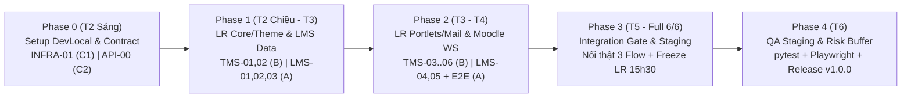

# KẾ HOẠCH PHASE, BẢNG CÔNG VIỆC OPENPROJECT & ĐẶC TẢ TỪNG TASK (`MEKO-DLE`)

Tài liệu chia **5 Phase trong Tuần 1 (16/11 → 20/11/2026)**, nêu rõ **kết quả từng ngày**, kèm **14 Work Packages chuẩn OpenProject** (đủ Subject, Parent/Phân hệ, Thời gian, Dự toán giờ, Nhánh Git, Phạm vi File/Module, Checklist `6` bước chi tiết & Tiêu chí nghiệm thu DoD) để tạo và log time trực tiếp lên **OpenProject**.

---

## 1. Overview & Lộ trình 5 Phase (Sprint 1 Tuần: T2 16/11 → T6 20/11)

- **Phân vai 3 Cặp ca:**
  - **Nhóm T2–T5 (`B1, B2` — nghỉ T6): Chuyên trách Liferay (`MEKO-TMS`).** Hoàn thiện Core Java, `meko-portal-theme`, Portlets và Webhook trước **15:30 Code Freeze T5**.
  - **Nhóm Off T4 (`C1, C2` — làm `T2, T3, T5, T6`): Nhóm Mix (Infra + API Bridge + Staging).** Dựng `devlocal`, chốt Mock API sớm T2 chiều cho Liferay chạy trước, hỗ trợ glue/sample, cấu hình RBAC và Deploy Staging.
  - **Nhóm T3–T6 (`A1, A2` — nghỉ T2): Chuyên trách Moodle (`MEKO-LMS`) & Test E2E.** Code bộ plugin IMS/WS/Theme Moodle và trực tiếp chạy QA `pytest`/`Playwright` + sửa lỗi Staging tới hết T6.

### Bảng Chốt Kết quả Theo Ngày & Phase

| Phase | Thời điểm | Ai làm | Mục tiêu & Kết quả Bắt buộc Cuối Ngày |
| :--- | :--- | :--- | :--- |
| **Phase 0** | **T2 Sáng (16/11)** | `B1, B2, C1, C2` *(A nghỉ)* | Chốt tài liệu `index.html`, kéo `meko-devlocal` (`5` container gồm Mailpit) chạy thông trên máy cá nhân, tạo nhánh `main` / `develop` / `staging` trên `huyriddle/meko-dle`. |
| **Phase 1A** | **T2 Chiều (16/11)** | `B1, B2` (LR) + `C1, C2` (Mix) | `C2` xong **Mock API HTTP 200** + PHP Stub (`MEKO-API-00`); `B1` xong **`tms-core` Service Builder 10 bảng (đủ Audit)** Postgres 17 (`MEKO-TMS-02`); `B2` lên khung **`meko-portal-theme.war`** (`MEKO-TMS-01`); `C1` hoàn tất `devlocal` + **Mailpit `/mail`**. |
| **Phase 1B** | **T3 (17/11)** *(6/6)* | Cả 6 người | `B1/B2` code `MoodleRestClient`, LMB Queue, Email Mailpit & khung Portlets chạy với Mock; `A2` dọn fallback `theme_meko` & seed `12` khóa thật + `format_tiles` + `mod_customcert`; `A1` xong Export **`.imscc` mẫu thật** (`MEKO-LMS-03`). |
| **Phase 2** | **T4 (18/11)** | `B1, B2` (LR) + `A1, A2` (Moodle/Test) *(C nghỉ)* | `A1` xong toàn bộ WS Import `.imscc` + Sync + Webhook HMAC; `B1/B2` hoàn thiện **Triển khai LMS**, **Import Excel `.xlsx`** + **Email Mailpit**, **Hồ sơ + PDF QR + `/tms/verify`**; `A2` viết xong bộ script `pytest` + `Playwright`. |
| **Phase 3** | **T5 (19/11)** *(6/6)* | Cả 6 người | **Integration Gate:** Gỡ Mock, nối thật `100%` TMS ↔ LMS thông cả `3` Flow trên `meko.localhost` → **15:30 Code Freeze Liferay (B1/B2)** → `C1/C2` cài RBAC 5 vai trò & **Deploy Staging (`v1.0.0-RC1`)**. |
| **Phase 4** | **T6 (20/11)** | `A1, A2` (Moodle/Test) + `C1, C2` (Mix) *(B nghỉ)* | Chạy Full **QA Staging** (`pytest` + `Playwright`) + **Risk Buffer 0.5 ngày** fix dứt điểm lỗi cấu hình/Moodle/Staging → Đóng gói Release **`v1.0.0`**. |

---

## 2. Bảng Tổng hợp 14 Work Packages (Chuẩn Đưa lên & Log Time OpenProject)

| Mã OP | OP Subject | Phân hệ | Phase | Phụ trách | Ngày (11/2026) | Dự toán | Phụ thuộc | Kết quả đầu ra chính |
| :--- | :--- | :---: | :---: | :---: | :---: | :---: | :---: | :--- |
| **`MEKO-INFRA-01`** | Dựng cụm `meko-devlocal` (5 container + Mailpit) & Repo `meko-dle` | Infra | Phase 0 | `Dev C1` | `16/11` | `12h` | `-` | `meko.localhost` thông `/`, `/tms`, `/lms`, `/mail` + CI/CD |
| **`MEKO-API-00`** | Thiết kế OpenAPI Contract, JSON Mock HTTP 200 & Moodle PHP Stub | Chung (Mix) | Phase 1A | `Dev C2` | `16/11` | `10h` | `INFRA-01` | OpenAPI + `mock_api.py` + `external_api` stub |
| **`MEKO-LMS-01`** | Dọn nốt fallback `theme_meko` (`NLS-*`, URL `dev3/dev5`) & đồng bộ CBE | LMS | Phase 1B | `Dev A2` | `17/11` | `6h` | `INFRA-01` | `theme_meko.zip` sạch `100%` fallback ACCEES |
| **`MEKO-LMS-02`** | Cài DigComp, Tiles, Quiz CBE, CustomCert QR & Seed 12 khóa thật | LMS | Phase 1B | `Dev A2` | `17/11–18/11` | `12h` | `LMS-01` | 12 khóa 4 Tiles + Quiz `7.0` + Cert QR + Badges |
| **`MEKO-LMS-03`** | Lập trình Plugin Export khóa học chuẩn IMS CC (`local_meko_imscp`) | LMS | Phase 1B | `Dev A1` | `17/11` | `10h` | `INFRA-01` | `local_meko_imscp.zip` export file `.imscc` chuẩn |
| **`MEKO-LMS-04`** | Lập trình WS Import & Khởi tạo khóa học từ `.imscc` | LMS | Phase 2 | `Dev A1` | `18/11` | `10h` | `LMS-03` | WS `local_meko_imscp_create_course` tạo lớp thật |
| **`MEKO-LMS-05`** | Lập trình WS Sync Courses, Enrol Bulk, Results & Webhook HMAC | LMS | Phase 2 | `Dev A1` | `18/11–19/11` | `12h` | `API-00` | `local_meko_sync_api.zip` + Token + Webhook |
| **`MEKO-TMS-01`** | Xây dựng Liferay Theme `meko-portal-theme` (1 Theme + 2 Layout) | TMS | Phase 1A | `Dev B2` | `16/11–17/11` | `10h` | `INFRA-01` | `meko-portal-theme.war` chạy Top Bar & Left Sidebar |
| **`MEKO-TMS-02`** | Xây dựng Core Service Builder `tms-core` (10 thực thể đủ Audit, Postgres 17) | TMS | Phase 1A | `Dev B1` | `16/11–17/11` | `10h` | `INFRA-01` | `tms-core-api.jar` & `tms-core-service.jar` Active |
| **`MEKO-TMS-03`** | Lập trình `tms-integration` (Moodle/Identity), LMB Queue & Email Mailpit | TMS | Phase 1B–2 | `Dev B1` | `17/11–18/11` | `14h` | `TMS-02`, `API-00` | `tms-integration.jar` + `tms-async.jar` + Mailpit |
| **`MEKO-TMS-04`** | Lập trình Portlet Quản lý Lớp & Triển khai LMS (`tms-course-admin-web`) | TMS | Phase 1B–2 | `Dev B2` | `17/11–18/11` | `8h` | `TMS-01`, `TMS-03` | Portlet tạo/mở lớp & nút Triển khai sang Moodle |
| **`MEKO-TMS-05`** | Lập trình Catalog 1-Click, Duyệt & Import Excel (`tms-enrollment-admin-web`) | TMS | Phase 1B–2 | `Dev B2` | `17/11–18/11` | `8h` | `TMS-03` | Catalog ảnh thật + Import `.xlsx` 6 cột đồng bộ LMS |
| **`MEKO-TMS-06`** | Lập trình Hồ sơ Học viên, PDF QR, Verify & Webhook (`tms-profile-web`, `tms-rest`) | TMS | Phase 2 | `Dev B1 + B2` | `18/11–19/11` | `14h` | `TMS-03`, `LMS-05` | Nhận Webhook (`B1`), tải PDF QR & `/tms/verify` (`B2`) |
| **`MEKO-TMS-07`** | Cấu hình RBAC 5 Vai trò, Deploy Staging & Kiểm thử E2E (`pytest`/Playwright) | Mix + QA | Phase 3–4 | `A2 + C1 + C2` | `19/11–20/11` | `32h` | All | Staging `v1.0.0` chạy thông `3` Flow `100%` Pass |

---

## 3. Đặc tả Chi tiết 14 Work Packages (Dán trực tiếp vào Description của OpenProject)

### 3.1. Nhóm Hạ tầng & Hợp đồng API (`MEKO-INFRA-01`, `MEKO-API-00`)

#### `[MEKO-INFRA-01]` Dựng cụm `meko-devlocal` (5 container + Mailpit) & Repo `meko-dle`
- **Thông số OP:** `Type: Task` | `Phân hệ: Infra` | `Phụ trách: Dev C1` | `Thời gian: 16/11 (Phase 0)` | `Dự toán: 12h` | `Branch: feature/MEKO-INFRA-01-devlocal`
- **Phạm vi thư mục:** `meko-devlocal/`, `.github/workflows/`, `.github/CODEOWNERS`, `.github/PULL_REQUEST_TEMPLATE.md`
- **Mô tả yêu cầu:** Dựng bộ Docker Compose local chuẩn 5 container gồm `nginx:alpine` (port 80 gateway), `postgres:17-alpine` (tách 2 DB `lportal` + `accees_lms`), `liferay/portal:7.4.3.132-ga132` (cấu hình SMTP trỏ `mailpit:1025`), `elestio/moodle:v5.3.0` (subpath `/lms`), `axllent/mailpit:latest` (SMTP `:1025`, Web `/mail` & `:8025`). Thiết lập cấu trúc repo `huyriddle/meko-dle` với nhánh `main`, `staging`, `develop` và 3 workflow CI/CD.
- **Checklist 6 bước thực hiện (Log Time):**
  1. **Thiết kế Topology & Port (`1.5h`):** Chốt file `nginx.conf` định tuyến `/`, `/tms`, `/lms`, `/mail`, `/dev-info` không đụng đường dẫn tĩnh Liferay/Moodle.
  2. **Chuẩn bị Env & Script mẫu (`1.5h`):** Tạo `.env.example` (`DOMAIN=meko.localhost`), script tự kiểm tra port 80 bận và thêm dự phòng `127.0.0.1 meko.localhost` vào `hosts` nếu CLI cần.
  3. **Chốt cấu hình DB & Mailpit (`2h`):** Viết `postgres/init-dbs.sql` tạo 2 DB + user riêng; cấu hình `portal-ext.properties` trỏ Mailpit (`mail.session.mail.smtp.host=mailpit`, `port=1025`).
  4. **Code `docker-compose.yml`, `setup.ps1`, `setup.sh` (`3h`):** Hoàn thiện script chạy 1-click và đẩy workflows CI (`ci-lms.yml`, `ci-tms.yml`, `cd-staging.yml`) + `CODEOWNERS`.
  5. **Đóng gói & Push khung chuẩn lên nhánh `develop` (`2h`):** Tag bản `devlocal-base` để 5 dev còn lại pull về chạy ngay.
  6. **Kiểm thử thông tuyến (`2h`):** Chạy `setup.ps1` trên máy sạch; verify HTTP `200` cả `/`, `/tms`, `/lms`, `/mail`; gửi thử 1 mail test tới `mailpit:1025` thấy hiện trên Web `/mail`.
- **Tiêu chí nghiệm thu (DoD):**
  - `[ ]` Dev bất kỳ clone `meko-dle` + chạy `setup.ps1/.sh` lên đủ 5 container không lỗi subpath.
  - `[ ]` `http://meko.localhost/lms`, `/tms`, `/mail` đều trả HTTP `200`.
  - `[ ]` CI `ci-lms.yml` và `ci-tms.yml` kích hoạt đúng khi mở Pull Request vào `develop`.

---

#### `[MEKO-API-00]` Thiết kế OpenAPI Contract, JSON Mock HTTP 200 & Moodle PHP Stub
- **Thông số OP:** `Type: Task` | `Phân hệ: Chung (Mix)` | `Phụ trách: Dev C2` | `Thời gian: 16/11 chiều (Phase 1A)` | `Dự toán: 10h` | `Phụ thuộc: MEKO-INFRA-01` | `Branch: feature/MEKO-API-00-contracts`
- **Phạm vi thư mục:** `meko-samples/api-contracts/`, `meko-samples/mock-server/`, `meko-samples/excel/`, `meko-lms/local/meko_sync_api/classes/external/`
- **Mô tả yêu cầu:** Khóa hợp đồng dữ liệu JSON giữa Liferay và Moodle để Cặp B (Liferay) lập trình tích hợp song song với Cặp A (Moodle) mà không phải chờ API thật. Đồng thời chuẩn bị bộ file mẫu thực tế (`.xlsx` 6 cột, đề thi Aiken `.txt`, mẫu cấu trúc `.imscc`).
- **Checklist 6 bước thực hiện (Log Time):**
  1. **Thiết kế OpenAPI Schema (`2h`):** Viết `moodle-tms-openapi.yaml` khóa đúng tên trường của `4` WS (`create_course`, `get_courses`, `enrol_users_bulk`, `get_learner_results`) và Webhook `badge-awarded`.
  2. **Tạo cặp JSON Request/Response & Sample Excel/Aiken (`2h`):** Tạo `course_sample.json`, `enrol_request.json`, `webhook_badge.json`, file `mau_ghi_danh_20hv.xlsx` (6 cột chuẩn) và đề thi `quiz_sample_aiken.txt`.
  3. **Đặc tả Header bảo mật Webhook (`1h`):** Khóa công thức chữ ký `X-MEKO-Signature: sha256=<HMAC_SHA256(body, secret)>`.
  4. **Code `mock_api.py` & PHP `external_api` Stub (`3h`):** Dựng FastAPI/HTTP mock server trả JSON chuẩn HTTP 200 + tạo khung class `external_api` trống cho `local_meko_sync_api`.
  5. **Đẩy lên nhánh `develop` (`1h`):** Publish trong `meko-samples/` kèm `README.md` hướng dẫn chạy mock trên port `8099`.
  6. **Kiểm thử gọi Mock từ máy Dev (`1h`):** Dùng `curl`/`pytest` test đủ 5 endpoint Mock API và kiểm tra `/lms/admin/webservice/documentation.php` nhận diện hàm Stub.
- **Tiêu chí nghiệm thu (DoD):**
  - `[ ]` Dev B1 (Liferay) gọi được `mock_api.py` nhận JSON hợp lệ của cả 4 API + bắn giả Webhook.
  - `[ ]` Có sẵn `mau_ghi_danh_20hv.xlsx` và `quiz_sample_aiken.txt` trong `meko-samples/`.

---

### 3.2. Nhóm Phân hệ Moodle LMS (`MEKO-LMS-01` → `MEKO-LMS-05` — Nhóm T3–T6)

#### `[MEKO-LMS-01]` Dọn nốt fallback `theme_meko` (`NLS-*`, URL `dev3/dev5`) & đồng bộ header CBE
- **Thông số OP:** `Type: Task` | `Phân hệ: MEKO-LMS` | `Phụ trách: Dev A2` | `Thời gian: 17/11 (Phase 1B)` | `Dự toán: 6h` | `Phụ thuộc: MEKO-INFRA-01` | `Branch: feature/MEKO-LMS-01-theme-clean`
- **Phạm vi file:** `meko-lms/theme_meko/lib.php`, `meko-lms/theme_meko/settings.php`, `meko-lms/theme_meko/classes/output/core_course_renderer.php`, `meko-lms/theme_meko/layout/competencies.php`
- **Mô tả yêu cầu:** Dọn sạch toàn bộ mảng fallback gán cứng còn sót từ dự án ACCEES trong `lib.php` và URL mặc định `dev3.accees.vn` / `dev5.accees.vn` trong `settings.php`; giữ nguyên cấu hình `brand_profile = 'meko'` và đọc `100%` dữ liệu thật từ DB Moodle (Custom Fields API, `course_overviewfiles`, `role_assignments`). Đồng bộ Header trang Khung năng lực giống trang chủ `01` (ẩn `Khóa học của tôi` với Guest).
- **Checklist 6 bước thực hiện (Log Time):**
  1. **Rà soát toàn bộ hardcode còn sót (`0.5h`):** Quét regex các biến `$defaultinstructors`, `$en_titles`, `$startdates_map`, `$duration_map`, `$institutions`, chuỗi `CTU`, URL `dev3/dev5` trong `theme_meko/`.
  2. **Kiểm tra dữ liệu DB thật trên DevLocal (`0.5h`):** Đảm bảo 12 khóa học trong DB đã có đủ Custom Fields, ảnh bìa, giảng viên `editingteacher`.
  3. **Sửa `settings.php` & chuẩn hóa Brand `meko` (`1h`):** Đặt default `tms_url`/`sso_url` đọc env hoặc để trống sạch; không trỏ mặc định về `accees.vn`.
  4. **Xóa fallback maps trong `lib.php` & đồng bộ `competencies.php` (`2h`):** Thay mảng fallback bằng query DB qua `\core_course\customfield\course_handler` + fallback rỗng/chung tính nếu DB thiếu; chỉnh header `competencies.php` theo mockup `04`.
  5. **Đóng gói `theme_meko.zip` & kiểm tra CI Lint (`1h`):** Chạy `php -l` toàn bộ file PHP và script kiểm tra `0% Emoji`, `0% Gradient`.
  6. **Test UI với Playwright (`1h`):** Mở `/lms`, `/lms/course/index.php`, `/lms/my/`, `/lms/theme/meko/competencies.php` kiểm tra `0` lỗi console và menu hiển thị đúng theo trạng thái Guest/Student.
- **Tiêu chí nghiệm thu (DoD):**
  - `[ ]` Không còn `NLS-01-*`, `CTU`, `dev3.accees.vn`, `dev5.accees.vn` trong `theme_meko/lib.php` & `settings.php`.
  - `[ ]` Sửa tên khóa học hoặc Custom Field trong DB Moodle → giao diện đổi theo ngay lập tức.

---

#### `[MEKO-LMS-02]` Cài Khung năng lực số, Tiles, Quiz CBE, CustomCert QR & Seed 12 khóa thật
- **Thông số OP:** `Type: Task` | `Phân hệ: MEKO-LMS` | `Phụ trách: Dev A2` | `Thời gian: 17/11–18/11 (Phase 1B–2)` | `Dự toán: 12h` | `Phụ thuộc: MEKO-LMS-01` | `Branch: feature/MEKO-LMS-02-cbe-seed`
- **Phạm vi thư mục:** `meko-lms/local/meko_competencies/`, `meko-devlocal/moodle/seed_real_data.php`, `meko-lms/theme_meko/pix/courses/`
- **Mô tả yêu cầu:** Chuyển đổi plugin năng lực sang namespace `local_meko_competencies`, cài `format_tiles` và `mod_customcert`, thiết lập phôi chứng chỉ PDF có QR xác thực và cấu hình hoàn thành Competency tự động khi học viên đạt Quiz `>= 70%`.
- **Checklist 6 bước thực hiện (Log Time):**
  1. **Thiết kế ma trận 2 Khung năng lực & 12 khóa (`1.5h`):** Chốt ánh xạ chuẩn DigComp 2.2 & DigCompEdu vào 12 khóa mẫu (Mockup `04`, `05`).
  2. **Chuẩn bị CSV khung năng lực, 12 ảnh `.jpg` & đề thi Aiken (`2h`):** Đảm bảo đủ ảnh cover trong `pix/courses/`, bộ câu hỏi Quiz 10 câu/khóa.
  3. **Cài rule CBE & phôi CustomCert QR (`2.5h`):** Cấu hình rule hoàn thành Quiz (`gradepass = 7.0`) → tự động đạt Competency + kích hoạt cấp Open Badge + phôi PDF CustomCert đặt biến QR.
  4. **Viết & nâng cấp script CLI `seed_real_data.php` (`3h`):** Idempotent seed 12 khóa dạng 4 Tiles, gắn giảng viên, nạp ảnh vào `course/overviewfiles`, điền đủ 5 Custom Fields.
  5. **Đóng gói `local_meko_competencies.zip` (`1h`):** Kiểm tra `version.php`, `db/access.php`, xóa hardcode chuỗi `ACCEES`.
  6. **Verify luồng học & cấp chứng chỉ trên `/lms` (`2h`):** Đăng nhập học viên mẫu, làm thử Quiz đạt `8/10` → xác nhận Competency lên `Proficient = Yes`, nhận Badge và tải được PDF có mã QR.
- **Tiêu chí nghiệm thu (DoD):**
  - `[ ]` `seed_real_data.php` chạy lại nhiều lần không lỗi trùng dữ liệu; đủ `12` khóa có ảnh thật, `4` Tiles, Quiz, CustomCert.
  - `[ ]` Làm Quiz `>= 70%` trên Moodle tự động đạt Competency & sinh Badge.

---

#### `[MEKO-LMS-03]` Lập trình Plugin Export khóa học chuẩn IMS CC (`local_meko_imscp`)
- **Thông số OP:** `Type: Task` | `Phân hệ: MEKO-LMS` | `Phụ trách: Dev A1` | `Thời gian: 17/11 (Phase 1B)` | `Dự toán: 10h` | `Phụ thuộc: MEKO-INFRA-01` | `Branch: feature/MEKO-LMS-03-imscp-export`
- **Phạm vi thư mục:** `meko-lms/local/meko_imscp/` (`version.php`, `lib.php`, `classes/exporter/`, `classes/external/export_course.php`, `db/services.php`, `db/access.php`)
- **Số lượng API & Đặc tả tham chiếu:** **1 Moodle WS (`local_meko_imscp_export_course`)** — Xem cấu trúc ZIP, XML `imsmanifest.xml` & Contract Input/Output tại **`02_DATA_FLOW_SB_AND_API.md` (Mục 2.7 & 4.1 API #1)**.
- **Mô tả yêu cầu:** Xây dựng công cụ đóng gói khóa học Moodle 5.3 ra file chuẩn mở `.imscc` (ZIP chứa `imsmanifest.xml` chuẩn IMS CC 1.1, bài học HTML trong `resources/`, câu hỏi trắc nghiệm chuẩn **QTI XML 1.2** trong `quizzes/`, và metadata LOM + `accees_*` custom fields), **không dùng định dạng `.mbz` độc quyền của Moodle**. Đọc 5 bảng `mdl_course`, `mdl_course_sections`, `mdl_page`/`mdl_resource`, `mdl_quiz`/`mdl_question`, `mdl_competency_coursecomp`; không export `mdl_user`.
- **Checklist 6 bước thực hiện (Log Time):**
  1. **Thiết kế cấu trúc `imsmanifest.xml` & ánh xạ QTI (`1.5h`):** Khớp cấu trúc Tiles sections → `organizations`, Page/File → `webcontent`, Quiz `multichoice`/`truefalse` → QTI 1.2 XML.
  2. **Chuẩn bị khóa học nguồn chuẩn 4 Tiles để Export (`1h`):** Chọn 1 khóa mẫu có Page, PDF resource và Quiz 10 câu.
  3. **Khai báo Capability & Service `db/services.php` (`1h`):** Gắn quyền `local/meko_imscp:export` cho Manager & Course Creator.
  4. **Lập trình `imscp_exporter.php` & WS `export_course` (`4h`):** Dùng `ZipArchive` đóng gói `imsmanifest.xml`, trích xuất nội dung Page, file đính kèm và convert bảng `mdl_question` sang QTI XML; trả link download `.imscc`.
  5. **Đóng gói plugin `local_meko_imscp.zip` (`1h`):** Kiểm tra chuẩn PSR-12 / Moodle Coding Style.
  6. **Kiểm thử giải nén & xác thực XML (`1.5h`):** Chạy `pytest` gọi WS export khóa mẫu → tải file `.imscc`, kiểm tra `imsmanifest.xml` hợp lệ và có đủ bài học + câu hỏi QTI.
- **Tiêu chí nghiệm thu (DoD):**
  - `[ ]` Xuất thành công file `<shortname>.imscc` từ giao diện Settings khóa học lẫn qua Web Service `local_meko_imscp_export_course`.
  - `[ ]` File `.imscc` giải nén có đủ `imsmanifest.xml`, `resources/*.html`, `quizzes/*.xml`.

---

#### `[MEKO-LMS-04]` Lập trình WS API Import & Khởi tạo khóa học từ `.imscc`
- **Thông số OP:** `Type: Task` | `Phân hệ: MEKO-LMS` | `Phụ trách: Dev A1` | `Thời gian: 18/11 (Phase 2)` | `Dự toán: 10h` | `Phụ thuộc: MEKO-LMS-03` | `Branch: feature/MEKO-LMS-04-imscp-import`
- **Phạm vi file:** `meko-lms/local/meko_imscp/classes/importer/imscp_importer.php`, `meko-lms/local/meko_imscp/classes/external/create_course.php`, `db/services.php`
- **Số lượng API & Đặc tả tham chiếu:** **1 Moodle WS (`local_meko_imscp_create_course`)** — Xem Input/Output/Error Codes & bảng Mapping 2 chiều tại **`02_DATA_FLOW_SB_AND_API.md` (Mục 2.7 & 4.1 API #2)**.
- **Mô tả yêu cầu:** Bổ sung Web Service **`local_meko_imscp_create_course`** nhận đầu vào `imscc_source_type` (`URL` hoặc `BASE64`) + `5` Custom Fields + `lecturer_email` + `competency_idnumbers[]`: tự động tạo Category nếu thiếu, tạo khóa định dạng `tiles`, bung toàn bộ `resources/*.html`, `resources/*.pdf`, `quizzes/*.xml` (QTI 1.2 → Question Bank + `mod_quiz` đặt `gradepass=7.0`), gán giảng viên & Competency. Phải **idempotent theo `shortname`** (`idempotent_reused = true` nếu lớp đã tồn tại).
- **Checklist 6 bước thực hiện (Log Time):**
  1. **Thiết kế luồng Parser & Transaction rollback (`1.5h`):** Khóa cấu trúc JSON Input khớp `MEKO-API-00`.
  2. **Chuẩn bị gói `.imscc` mẫu & payload test (`1h`):** Lấy output của `MEKO-LMS-03` làm input kiểm thử.
  3. **Đăng ký WS `local_meko_imscp_create_course` (`1h`):** Khai báo đầy đủ `external_function_parameters` và kiểm tra quyền `local/meko_imscp:import`.
  4. **Lập trình Parser XML + Course/Quiz Builder (`4.5h`):** Parse `imsmanifest.xml` → tạo sections Tiles → tạo `mod_page`, `mod_resource`, `mod_quiz` (nạp câu hỏi QTI vào question bank với `gradepass = 7.0`) → gán ảnh bìa & 5 Custom Fields → gắn competency links.
  5. **Xử lý Idempotency & Error Handling (`1h`):** Nếu `shortname` đã tồn tại thì cập nhật metadata & trả `moodle_course_id` hiện có thay vì báo lỗi 500.
  6. **Chạy `pytest` test tạo lớp từ `.imscc` (`1h`):** Verify khóa học mới mở được ngay trên `/lms/course/view.php?id=...` với đủ 4 Tiles và Quiz.
- **Tiêu chí nghiệm thu (DoD):**
  - `[ ]` Gọi REST `local_meko_imscp_create_course` trả JSON `{ moodle_course_id, shortname, course_url, imported_modules }`.
  - `[ ]` Khóa học mới trên `/lms` có đủ Tiles, Quiz làm được bài, Custom Fields và Competency.

---

#### `[MEKO-LMS-05]` Lập trình WS Sync Courses, Enrol Bulk, Results & Webhook HMAC (`local_meko_sync_api`)
- **Thông số OP:** `Type: Task` | `Phân hệ: MEKO-LMS` | `Phụ trách: Dev A1` | `Thời gian: 18/11–19/11 (Phase 2–3)` | `Dự toán: 12h` | `Phụ thuộc: MEKO-API-00` | `Branch: feature/MEKO-LMS-05-sync-api`
- **Phạm vi thư mục:** `meko-lms/local/meko_sync_api/` (`classes/external/`, `classes/observer.php`, `classes/task/send_webhook_task.php`, `db/events.php`, `db/services.php`, `settings.php`)
- **Số lượng API & Đặc tả tham chiếu:** **4 Moodle WS + 1 Event Observer Webhook** — Xem chi tiết Input/Output/Error tại **`02_DATA_FLOW_SB_AND_API.md` (Mục 4.1 API #3–#6 & 4.2 API #7)**.
- **Mô tả yêu cầu:** Xây dựng trọn bộ Web Services đồng bộ 2 chiều và cơ chế bắn Webhook bảo mật sang Liferay:
  - API #3 `local_meko_sync_get_courses`: trả danh sách khóa học kèm điều kiện lọc (`visible = 1`, `accees_course_status = PUBLISHED`, ảnh cover, 5 Custom Fields, `competency_idnumbers`).
  - API #4 `local_meko_sync_update_courses`: đổi trạng thái ẩn/hiện (`visible`) & `accees_course_status` (`CLOSED`) khi TMS đóng lớp.
  - API #5 `local_meko_sync_enrol_users_bulk`: nhận tối đa 50 user/lần, kiểm tra `mdl_user` theo `email`; chưa có thì **tạo tài khoản mới** (hỗ trợ `auth_type = manual` trả về `temp_password` hoặc `oidc` khi bật SSO), rồi enrol vai trò Student (`roleid = 5`).
  - API #6 `local_meko_sync_get_learner_results`: trả tiến độ hoàn thành khóa, điểm Quiz, trạng thái đạt Competency và Badge cho Scheduler đối soát.
  - Event Observer bắt `\core\event\badge_awarded` & `\core\event\course_completed` đẩy Ad-hoc Task POST JSON + header `X-MEKO-Signature` sang `tms-rest`.
- **Checklist 6 bước thực hiện (Log Time):**
  1. **Khớp nối Signature với `MEKO-API-00` (`1h`):** Rà soát toàn bộ kiểu dữ liệu input/output của 4 WS + Event Webhook.
  2. **Cấu hình Web Service Token & User Service trên DevLocal (`1h`):** Tạo External Service `MEKO_TMS_SYNC` và gán capability cho token dev.
  3. **Cài `db/services.php`, `db/events.php` & `settings.php` (`1.5h`):** Cho phép cấu hình `webhook_url` và `webhook_secret` trong Admin Settings Moodle (0% hardcode).
  4. **Lập trình 4 `external_api` classes & `send_webhook_task.php` (`5.5h`):** Cài logic bulk enrol idempotent + ký HMAC-SHA256 + retry khi Liferay chưa kịp phản hồi.
  5. **Đóng gói `local_meko_sync_api.zip` (`1h`):** Kiểm tra PHP syntax & coding standards.
  6. **Chạy `pytest` test 4 WS + Mock Webhook Receiver (`2h`):** Xác nhận enrol 20 user chạy `< 3s`, tạo user mới chuẩn `auth=manual`, bắn đúng chữ ký `X-MEKO-Signature`.
- **Tiêu chí nghiệm thu (DoD):**
  - `[ ]` Đủ 4 Web Services hoạt động trả JSON khớp `100%` Contract `MEKO-API-00`.
  - `[ ]` Ghi danh user mới qua API tạo được user bên Moodle và đăng nhập học được ngay.
  - `[ ]` Đạt Badge trên Moodle tự động bắn Ad-hoc Webhook với chữ ký `HMAC-SHA256` hợp lệ.

---

### 3.3. Nhóm Phân hệ Liferay TMS (`MEKO-TMS-01` → `MEKO-TMS-06` — Nhóm T2–T5)

#### `[MEKO-TMS-01]` Xây dựng Liferay Theme `meko-portal-theme` (1 Theme + 2 Layout)
- **Thông số OP:** `Type: Task` | `Phân hệ: MEKO-TMS` | `Phụ trách: Dev B2` | `Thời gian: 16/11–17/11 (Phase 1A–1B)` | `Dự toán: 10h` | `Phụ thuộc: MEKO-INFRA-01` | `Branch: feature/MEKO-TMS-01-portal-theme`
- **Phạm vi thư mục:** `meko-tms/themes/meko-portal-theme/`, `meko-tms/layouttpl/meko-admin-sidebar-layout/`
- **Mô tả yêu cầu:** Tạo **DUY NHẤT 1 Liferay Theme** đồng bộ 100% nhận diện với `theme_meko` (Header trắng `58px`, `logo_meko.svg`, màu Solid `#0000B6` / `#39B500` / `#EA6400`, font `Be Vietnam Pro`, Footer `#0E1726`, 0% Emoji, 0% Gradient) kèm 2 dạng Page Layout tách vai trò không trộn lẫn:
  - Layout `/tms` (Public & Học viên): Top Navbar 1 dòng không rớt chữ; Khách thấy `Trang chủ | Khóa học | Tra cứu Chứng chỉ` + `Đăng nhập`; Học viên đã login thấy thêm `Hồ sơ Học tập` + Avatar.
  - Layout `/tms/admin` (Quản trị): Top Header `TMS ADMIN` + **Left Sidebar `250px`** chỉ chứa 3 mục quản trị (`Quản lý Lớp & Kế hoạch`, `Xét duyệt & Import Excel`, `Mẫu Email Thông báo`).
- **Checklist 6 bước thực hiện (Log Time):**
  1. **Đối chiếu Header/Footer chuẩn từ Mockup `01`, `07`–`10`, `15` (`1h`):** Khóa kích thước navbar `58px`, màu, spacing CSS.
  2. **Gom tài nguyên SVG/CSS/Fonts vào Theme (`1h`):** Nạp `logo_meko.svg`, nhúng font `Be Vietnam Pro` & Font Awesome 6.
  3. **Thiết kế Template FreeMarker `portal_normal.ftl` & `navigation.ftl` (`3h`):** Cài logic ẩn/hiện menu theo trạng thái đăng nhập & Layout Attribute `isAdminSpace`.
  4. **Xây dựng Layout Template `meko-admin-sidebar-layout` (`2.5h`):** Tạo khung Left Sidebar `250px` + vùng content bảng rộng cho trang `/tms/admin`.
  5. **Build `meko-portal-theme.war` bằng Gradle & Deploy (`1.5h`):** Deploy vào `devlocal-liferay`, cấu hình 2 Page `/tms` và `/tms/admin` qua Gogo/Site UI.
  6. **Kiểm tra đa màn hình bằng trình duyệt (`1h`):** Verify `0%` Emoji, `0%` Gradient, menu không rớt dòng ở 1280px & 1440px, tách sạch Khách/Học viên/Admin.
- **Tiêu chí nghiệm thu (DoD):**
  - `[ ]` Chỉ cài đúng `1` theme `meko-portal-theme.war`, giao diện `/` và `/tms` khớp tone Moodle `/lms`.
  - `[ ]` Không gian Học viên không có nút Admin; Left Sidebar Admin không dính link Hồ sơ cá nhân hay Verify công khai.

---

#### `[MEKO-TMS-02]` Xây dựng Core Service Builder `tms-core` (10 thực thể đầy đủ Audit, Postgres 17)
- **Thông số OP:** `Type: Task` | `Phân hệ: MEKO-TMS` | `Phụ trách: Dev B1` | `Thời gian: 16/11–17/11 (Phase 1A)` | `Dự toán: 10h` | `Phụ thuộc: MEKO-INFRA-01` | `Branch: feature/MEKO-TMS-02-service-builder`
- **Phạm vi thư mục:** `meko-tms/modules/tms-core/tms-core-api/`, `meko-tms/modules/tms-core/tms-core-service/`
- **Mô tả yêu cầu:** Xây dựng tầng persistence lõi trên Liferay Service Builder 7.4 kết nối PostgreSQL 17 cho đủ **10 thực thể** đặc tả tại `02_DATA_FLOW_SB_AND_API.md` (đều có đủ cột Audit chuẩn Liferay `companyId`, `groupId`, `userId`, `userName`, `createDate`, `modifiedDate`: `TMSCompetencyFramework`, `TMSCoursePlan`, `TMSCourse`, `TMSCourseCompetency`, `TMSStudent`, `TMSEnrollment`, `TMSStudentCertificate`, `TMSSyncLog`, `TMSEmailTemplate`, `TMSEmailLog`).
- **Checklist 6 bước thực hiện (Log Time):**
  1. **Rà soát ERD 10 bảng, Audit & kiểu dữ liệu Postgres 17 (`1h`):** Khóa khóa ngoại logic, index unique (`student_code`, `email`, `qr_verify_code`, `template_code`), bảo đảm 100% entity có cột Audit.
  2. **Chuẩn bị script seed bảng `tms_email_template` (`0.5h`):** Nạp sẵn 2 mẫu `ENROLLMENT_APPROVED` và `ENROLLMENT_REJECTED` (`0%` Emoji).
  3. **Soạn `service.xml` & `portlet-model-hints.xml` (`2.5h`):** Khai báo đủ cột, finder chuẩn + ép `TEXT` (`max-length="2000000"`) cho `courseDescription`, `lomPayloadJson`, `approvalNotes`, `lastSyncError`, `lastEmailError`, `revokeReason`, `requestPayload`, `responseBody`, `errorMessage`, `bodyHtml`, `renderedBodyHtml`.
  4. **Chạy `buildService` & Cài `LocalServiceImpl` (`3.5h`):** Cài đặt 6 nhóm hàm chuẩn trong `*LocalServiceImpl` (`create/update` có ghi Audit `userId`/`userName`, `getBy...`, `findPaginated`, `count...`, `searchByKeyword`, `updateSyncStatus`) theo đúng `03_CODING_PLAYBOOK.md`.
  5. **Build `.jar` & Deploy OSGi bundles (`1.5h`):** Chạy `./gradlew :modules:tms-core:deploy`, verify trạng thái `Active` trên Gogo Shell.
  6. **Kiểm tra sinh bảng thật trong DB `lportal` (`1h`):** Chạy `psql -c "\dt tms_*"` xác nhận sinh đủ 10 bảng (kể cả `tms_email_template` và `tms_email_log`) và viết integration call test CRUD cơ bản.
- **Tiêu chí nghiệm thu (DoD):**
  - `[ ]` Cả `vn.mekosoft.tms.core.api` và `vn.mekosoft.tms.core.service` ở trạng thái `Active` trong Gogo Shell.
  - `[ ]` PostgreSQL `lportal` có đủ `10` bảng `tms_*` đầy đủ cột Audit và sinh đúng kiểu `TEXT`.

---

#### `[MEKO-TMS-03]` Lập trình `tms-integration` (Moodle/Identity), LMB Queue & Email Mailpit
- **Thông số OP:** `Type: Task` | `Phân hệ: MEKO-TMS` | `Phụ trách: Dev B1` | `Thời gian: 17/11–18/11 (Phase 1B–2)` | `Dự toán: 14h` | `Phụ thuộc: MEKO-TMS-02, MEKO-API-00` | `Branch: feature/MEKO-TMS-03-integration-async`
- **Phạm vi thư mục:** `meko-tms/modules/tms-integration/`, `meko-tms/modules/tms-async/`
- **Mô tả yêu cầu:** Xây dựng lõi tích hợp theo mô hình Gateway nội bộ:
  - Trong `tms-integration`: tách 2 lib adapter là **`MoodleRestClient`** (gọi 4 WS Moodle, Retry 3x, ghi `TMSSyncLog`) và **`IdentityProvisioningService`** (chế độ hiện tại `LOCAL_DIRECT` kiểm tra/tạo User Liferay + `auth_type=manual` sang Moodle; sẵn sàng chuyển config OSGi sang `KEYCLOAK_SSO` mà không sửa Portlet).
  - Trong `tms-async`: dựng Liferay Message Bus Destination (`meko/tms/enrollment-sync`, `meko/tms/course-deploy`) xử lý bất đồng bộ + **`EmailNotificationService`** dùng sẵn lõi SMTP Liferay (`MailServiceUtil`) kết hợp mẫu FreeMarker riêng (`TMSEmailTemplate`: `ENROLLMENT_APPROVED` & `ENROLLMENT_REJECTED`) gửi qua **Mailpit (`devlocal-mailpit:1025`)** và ghi 100% lịch sử gửi vào bảng **`TMSEmailLog`** (`tms_email_log`).
- **Checklist 6 bước thực hiện (Log Time):**
  1. **Thiết kế OSGi Configuration Interface (`1.5h`):** Tạo `@Meta.OCD` cho `moodleBaseUrl`, `moodleWsToken`, `authMode (LOCAL_DIRECT|KEYCLOAK_SSO)`, `webhookSecret`, `mailFrom`.
  2. **Chuẩn bị 2 file template `.ftl` dự phòng & JSON payload test (`1h`):** Nạp `email_enrollment_approved.ftl` (mockup `11`) và `email_enrollment_rejected.ftl` (mockup `12`).
  3. **Khai báo LMB Destinations & Thread Pool (`1.5h`):** Đăng ký `SerialDestination` / `ParallelDestination` trong `tms-async`.
  4. **Lập trình `MoodleRestClient` & `IdentityProvisioningService` (`5h`):** Cài HttpClient pool, parse JSON Jackson, xử lý retry & ghi log `TMSSyncLog` cho mọi call API/Webhook.
  5. **Lập trình MessageListener & `EmailNotificationService` (`3h`):** Hỗ trợ gửi 2 loại mail (Chấp nhận khi `SYNCED` / Từ chối khi `REJECTED`), lưu snapshot HTML & kết quả vào `TMSEmailLog`, cập nhật `TMSEnrollment` và cho phép Admin bấm **Gửi lại Email**.
  6. **Kiểm thử Mock API + Mailpit (`/mail`) (`2h`):** Test cả duyệt (nhận) và từ chối (không nhận) → thấy `TMSSyncLog` & `TMSEmailLog` ghi đủ audit, mở `http://meko.localhost/mail` thấy đủ 2 mẫu thư khớp mockup `11` & `12`.
- **Tiêu chí nghiệm thu (DoD):**
  - `[ ]` Không hardcode URL/Token/Mật khẩu trong Java (100% đọc từ OSGi Configuration / Env).
  - `[ ]` Ghi danh thử tạo được user Liferay, gọi API Moodle (Mock hoặc thật) và gửi thành công email vào hộp thư **Mailpit** (`/mail`).

---

#### `[MEKO-TMS-04]` Lập trình Portlet Quản lý Lớp & Triển khai LMS (`tms-course-admin-web`)
- **Thông số OP:** `Type: Task` | `Phân hệ: MEKO-TMS` | `Phụ trách: Dev B2` | `Thời gian: 17/11–18/11 (Phase 1B–2)` | `Dự toán: 8h` | `Phụ thuộc: MEKO-TMS-01, MEKO-TMS-03` | `Branch: feature/MEKO-TMS-04-course-admin`
- **Phạm vi thư mục:** `meko-tms/modules/tms-course-admin-web/`
- **Số lượng Form & Command cần code:** **2 Form nhập liệu (Form 1 `TMSCoursePlan`, Form 2 `TMSCourse + TMSCourseCompetency`) + 4 `MVCActionCommand`** (`SaveCoursePlanAction`, `ApproveCoursePlanAction`, `SaveCourseAction`, `DeployToMoodleAction`) — Xem bảng Input từng ô & Ma trận Action #1–#5 tại **`02_DATA_FLOW_SB_AND_API.md` (Mục 2.6 & 4.3 Command #9–#12)** + Mockups **`08` & `13`**.
- **Mô tả yêu cầu:** Dựng Portlet quản trị tại `/tms/admin` (Left Sidebar) theo chuẩn MVC Portlet (`DisplayContext` + `<clay:management-toolbar>` + `<liferay-ui:search-container>`) + Form `13_liferay_tms_course_plan_form.html`: cho phép tạo & duyệt Kế hoạch mở khóa (`TMSCoursePlan`), tạo Lớp (`TMSCourse`), gắn Khung năng lực (`TMSCourseCompetency`), chuyển trạng thái `UPCOMING` → `ENROLLING` và bấm **Triển khai sang LMS** gọi `MoodleRestClient.createCourseFromIms()`.
- **Checklist 6 bước thực hiện (Log Time):**
  1. **Chốt UX bảng & modal theo Mockup `08` (`1h`):** Phân tách MVC List + Modal/Form tạo kế hoạch & nút Triển khai LMS.
  2. **Chuẩn bị gói `.imscc` mẫu liên kết trong Portlet (`0.5h`):** Cho phép chọn file `.imscc` từ Document Library hoặc URL mẫu.
  3. **Khai báo Portlet Keys & RBAC `default.xml` (`1h`):** Chỉ cho Role `Course Manager` / `Administrator` truy cập và thực hiện Action.
  4. **Lập trình `CourseManagementDisplayContext` & MVC Commands (`3.5h`):** Viết `ViewCoursesMVCRenderCommand`, `SaveCourseMVCActionCommand`, `DeployToMoodleMVCActionCommand`, dùng Post-Redirect-Get + `SessionMessages`.
  5. **Build & Deploy `.jar` lên `/tms/admin` (`1h`):** Gắn vào Layout Left Sidebar trang Quản lý Lớp & Kế hoạch.
  6. **Test UI luồng Quản trị Tạo → Mở chiêu sinh → Triển khai (`1h`):** Xác nhận trạng thái đổi sang `DEPLOYED`, lưu `moodle_course_id`, khóa học hiện ngay bên Catalog `/tms`.
- **Tiêu chí nghiệm thu (DoD):**
  - `[ ]` Giao diện `/tms/admin` khớp `100%` Mockup `08`, 0% Emoji/Gradient.
  - `[ ]` Bấm **Triển khai LMS** gọi thành công sang Moodle tạo lớp thật và lưu `moodle_course_id` về Postgres `lportal`.

---

#### `[MEKO-TMS-05]` Lập trình Catalog 1-Click, Duyệt & Import Excel (`tms-enrollment-admin-web`)
- **Thông số OP:** `Type: Task` | `Phân hệ: MEKO-TMS` | `Phụ trách: Dev B2` | `Thời gian: 17/11–18/11 (Phase 1B–2)` | `Dự toán: 8h` | `Phụ thuộc: MEKO-TMS-03` | `Branch: feature/MEKO-TMS-05-enrollment`
- **Phạm vi thư mục:** `meko-tms/modules/tms-enrollment-admin-web/`
- **Số lượng Command & Màn hình cần code:** **6 `MVCResourceCommand`** (`GetCatalogResource`, `SelfEnrollResource`, `ImportExcelPreviewResource`, `ImportExcelConfirmResource`, `ApproveRejectEnrollmentResource`, `ResendEmailResource`/`GetLogsResource`) + **2 mẫu Email** (`ENROLLMENT_APPROVED`, `ENROLLMENT_REJECTED`) — Xem Input/Output từng Command tại **`02_DATA_FLOW_SB_AND_API.md` (Mục 2.6 Action #6–#9 & Mục 4.3 Command #13–#18)** + Mockups **`07`, `09`, `11`, `12`, `14`**.
- **Mô tả yêu cầu:** Gồm 2 Portlet phục vụ cả 2 không gian (bám Mockup `07`, `09` và `14`):
  - **Widget 1 (`/tms` — Học viên):** Hiển thị Catalog khóa học `PUBLISHED` dùng ảnh cover thật, lọc trạng thái/năng lực, nút **Đăng ký ngay (1-Click)** (`SelfEnrollResource`).
  - **Widget 2 (`/tms/admin` — Cán bộ Ghi danh):** Tải file Excel mẫu 6 cột, Upload `.xlsx` đọc bằng Apache POI (preview & validate lỗi email/mã SV theo Mockup `14`), nút **Duyệt** (đẩy Queue LMB + gửi `ENROLLMENT_APPROVED`), nút **Từ chối** mở Modal nhập `rejectReason` (gửi `ENROLLMENT_REJECTED`), và bảng xem `TMSSyncLog`/`TMSEmailLog` kèm nút **Gửi lại Email**.
- **Checklist 6 bước thực hiện (Log Time):**
  1. **Thiết kế `LiferayBridgeContext` & API JSON nội bộ (`1h`):** Chốt cấu trúc truyền `resourceURL` + `p_auth` cho React.
  2. **Lấy file mẫu `.xlsx` 6 cột từ `meko-samples` (`0.5h`):** Nhúng vào chức năng "Tải mẫu Excel".
  3. **Khai báo `MVCResourceCommand` & phân quyền (`1h`):** Tách ResourceCommand công khai (xem Catalog) vs có đăng nhập (1-Click) vs Admin (Duyệt & Upload Excel).
  4. **Lập trình React Portlet + Apache POI Parser (`3.5h`):** Cài parse `.xlsx`, validate 6 cột, upsert `TMSStudent` + `TMSEnrollment`, đẩy Queue LMB.
  5. **Build Webpack/React + Gradle OSGi `.jar` (`1h`):** Deploy lên 2 trang `/tms` và `/tms/admin`.
  6. **Test Import `mau_ghi_danh_20hv.xlsx` & 1-Click (`1h`):** Kiểm tra 20 học viên lên `SYNCED`, có mặt trên `/lms` và 20 email vào **Mailpit** (`/mail`).
- **Tiêu chí nghiệm thu (DoD):**
  - `[ ]` Catalog `/tms` hiển thị ảnh khóa học thật đồng bộ `/lms`, đăng ký 1-Click mượt.
  - `[ ]` Upload `.xlsx` 20 dòng đẩy đồng bộ vào Moodle & gửi đủ 20 email xác nhận qua Mailpit.

---

#### `[MEKO-TMS-06]` Lập trình Hồ sơ Học viên, PDF QR, Verify & Webhook (`tms-profile-web`, `tms-rest`)
- **Thông số OP:** `Type: Task` | `Phân hệ: MEKO-TMS` | `Phụ trách: Dev B1 (Webhook/Backend) + Dev B2 (UI/PDF)` | `Thời gian: 18/11–19/11 (Phase 2–3)` | `Dự toán: 14h (B1: 8h, B2: 6h)` | `Phụ thuộc: MEKO-TMS-03, MEKO-LMS-05` | `Branch: feature/MEKO-TMS-06-profile-webhook`
- **Phạm vi thư mục:** `meko-tms/modules/tms-rest/`, `meko-tms/modules/tms-profile-web/`
- **Số lượng API & Command cần code:** **2 JAX-RS REST APIs (`tms-rest`: API #7 Webhook `badge-awarded`, API #8 `certificates/verify`) + 2 `MVCResourceCommand` (`tms-profile-web`: Command #19 `GetMyProfileResource`, #20 `DownloadCertificatePdfResource`)** — Xem chi tiết Input/Output/401/404 tại **`02_DATA_FLOW_SB_AND_API.md` (Mục 4.2 & 4.3)** + Mockups **`10` & `15`**.
- **Mô tả yêu cầu:** Hoàn thiện đầu ra cuối của chuỗi học tập:
  - **`tms-rest` (`Dev B1 - 8h`):** Expose `POST /o/meko-tms/api/webhooks/badge-awarded` verify `X-MEKO-Signature` (`HMAC-SHA256`), lưu `TMSStudentCertificate`, sinh `cert_serial_code` + `qr_verify_code`, render PDF chứng chỉ nhúng mã QR (ZXing + PDFBox/OpenPDF) lưu vào Liferay Document Library; kèm Scheduler chạy định kỳ đối soát `get_learner_results` phòng rớt Webhook; kèm API public `GET /o/meko-tms/api/certificates/verify?code=...` (trả `VALID` / `REVOKED` / `NOT_FOUND`).
  - **`tms-profile-web` (`Dev B2 - 6h`):** Dựng 2 màn hình khớp Mockup `10` & `15`: `/tms/my-profile` (cho Học viên xem bảng điểm, tiến độ năng lực, Huy hiệu, tải PDF QR) và `/tms/verify` (cho Khách công khai tra cứu mã QR).
- **Checklist 6 bước thực hiện (Log Time):**
  1. **Chốt payload Webhook & mẫu PDF Chứng chỉ QR (`1.5h`):** Khóa tọa độ QR, Serial, Điểm, Tên khóa trên phôi PDF.
  2. **Chuẩn bị JSON Webhook test & secret HMAC (`0.5h`):** Cấu hình trùng khớp với `local_meko_sync_api`.
  3. **Mở quyền JAX-RS & Public Route `/tms/verify` (`1.5h`):** Cấu hình `auth.verifier.guest.allowed=true` CHỈ cho 2 endpoint công khai (Webhook kiểm HMAC, Verify chỉ trả dữ liệu chứng chỉ công khai).
  4. **Lập trình Webhook Receiver, ZXing QR PDF Generator & Portlet UI (`7h`):** B1 làm `tms-rest` + PDF DL + Scheduler; B2 làm React/JSP `/tms/my-profile` & `/tms/verify`.
  5. **Build & Deploy `tms-rest.jar` + `tms-profile-web.jar` (`1.5h`):** Gắn Portlet đúng vị trí trên site `/tms`.
  6. **Test E2E Webhook → PDF → Verify (`2h`):** Bắn Webhook từ Quiz Moodle → kiểm tra `/tms/my-profile` hiện chứng chỉ mới → tải file PDF quét URL QR → mở `/tms/verify?code=...` hiện **CHỨNG CHỈ HỢP LỆ**.
- **Tiêu chí nghiệm thu (DoD):**
  - `[ ]` Sai chữ ký `X-MEKO-Signature` trả HTTP `401`; đúng chữ ký tự động cấp `TMSStudentCertificate` + file PDF tải được.
  - `[ ]` Trang `/tms/verify` tra cứu không cần đăng nhập, khớp Mockup `15`.

---

### 3.4. Nhóm RBAC, Staging & Kiểm thử E2E (`MEKO-TMS-07` — Nhóm Mix + T3–T6)

#### `[MEKO-TMS-07]` Cấu hình RBAC 5 Vai trò, Deploy Staging & Kiểm thử E2E (`pytest` / Playwright)
- **Thông số OP:** `Type: Task` | `Phân hệ: Mix + QA` | `Phụ trách: Dev A2 (QA E2E) + Dev C1 (RBAC/Staging) + Dev C2 (Mix/QA)` | `Thời gian: 19/11–20/11 (Phase 3–4)` | `Dự toán: 32h (A2: 14h, C1: 10h, C2: 8h)` | `Phụ thuộc: Tất cả task Phase 1–2` | `Branch: feature/MEKO-TMS-07-rbac-e2e`
- **Phạm vi thư mục:** `meko-samples/tests/pytest/`, `meko-samples/tests/playwright/`, `meko-tms/.../resource-actions/default.xml`
- **Mô tả yêu cầu:** Khóa phân quyền chặt chẽ 5 vai trò trên cả TMS & LMS (Học viên không thấy menu/action Quản trị và bị chặn ở tầng Action/Service), gom toàn bộ artifacts `.zip` / `.jar` / `.war` deploy lên Staging qua `cd-staging.yml`, và chạy bộ kiểm thử tự động kiểm chứng toàn vẹn `3` Flow nghiệp vụ trước khi đóng gói release `v1.0.0`.
- **Checklist 6 bước thực hiện (Log Time):**
  1. **Lập Ma trận RBAC 5 Vai trò & Danh sách Test Cases (`3h`):** Liệt kê quyền xem/sửa từng màn hình (`Guest`, `Student`, `Lecturer`, `Training Officer`, `Admin`) + `15` test cases cho `3` Flow.
  2. **Chuẩn bị dữ liệu test sạch trên Staging (`2h`):** Tài khoản test theo từng vai trò, file `.imscc`, file `.xlsx`, đề thi Aiken.
  3. **Cài `resource-actions/default.xml` & `PermissionChecker` (`5h`):** Dev C1 khóa chặt permission tại MVCCommand & Page View Permissions trên Liferay.
  4. **Viết bộ Test tự động `pytest` (API/Webhook/Mailpit) & `Playwright` (UI E2E) (`10h`):** Dev A2 & C2 code kịch bản chạy tự động kiểm tra Flow 1 (Deploy), Flow 2 (Excel + Mailpit), Flow 3 (Quiz + Webhook + PDF QR + Verify) và check 403/ẩn nút với tài khoản Student.
  5. **Merge `develop` → `staging` & Deploy Staging `v1.0.0-RC1` (`4h`):** Dev C1 chạy pipeline deploy toàn bộ artifact sang Staging.
  6. **Chạy Full QA Staging + Fix bug Risk Buffer T6 (`8h`):** Chạy 100% suite trên Staging, xử lý lỗi phát sinh chiều T6, re-test Pass và tạo Git Tag **`v1.0.0`**.
- **Tiêu chí nghiệm thu (DoD):**
  - `[ ]` Test RBAC: tài khoản Học viên truy cập URL `/tms/admin` hoặc gọi Action Quản trị bị từ chối.
  - `[ ]` Bộ `pytest` + `Playwright` chạy Pass `100%` cả `3` Flow trên Staging (`v1.0.0`).

---

## 4. Bản đồ 15 Mockup Chuẩn (`mockups/`)
- **MEKO-LMS (6 màn hình):** `01_moodle_lms_homepage.html`, `02_moodle_lms_course_catalog.html`, `03_moodle_lms_my_courses.html`, `04_moodle_lms_competencies.html`, `05_moodle_lms_course_view_tiles.html`, `06_moodle_lms_login_sso.html`.
- **MEKO-TMS (7 màn hình):** `07_liferay_tms_portal_home.html`, `08_liferay_tms_course_management.html`, `13_liferay_tms_course_plan_form.html` *(Form Tạo Plan & Mở Lớp)*, `09_liferay_tms_enrollment_records.html`, `14_liferay_tms_import_reject_logs.html` *(Import Excel Preview, Modal Từ chối & Nhật ký Email/Sync)*, `10_liferay_tms_learner_dashboard.html`, `15_tms_certificate_qr_verify.html`.
- **Email Notification (2 mẫu test qua Mailpit `http://meko.localhost/mail`):** `11_email_enrollment_notification.html` (`ENROLLMENT_APPROVED`), `12_email_enrollment_rejected.html` (`ENROLLMENT_REJECTED`).
