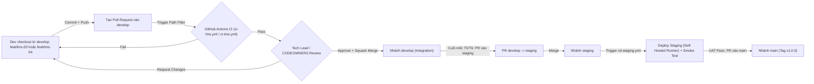

# TỔ CHỨC GITHUB (`meko-dle`), QUY TRÌNH COMMIT/PUSH, DUYỆT MERGE & CI/CD DEPLOY

Tài liệu quy chuẩn Git, cấu trúc Monorepo **`meko-dle`** trên GitHub, quy trình Review/Merge và Pipeline CI/CD tự động đẩy lên **Staging**.

---

## 1. Thông tin & Cấu trúc Repository `meko-dle`

| Thông tin | Chi tiết cấu hình |
| :--- | :--- |
| **Mô hình Repository** | **Monorepo** (`meko-dle`) — 1 repo chứa trọn bộ LMS, TMS, DevLocal, Samples & Docs để dev clone 1 lần chạy toàn hệ sinh thái. |
| **URL GitHub (dự kiến)** | `https://github.com/huyriddle/meko-dle.git` *(Private Repo — hoặc GitHub Organization `github.com/meko-dle/meko-dle.git`)* |
| **Nhánh chính** | `main` (Production/Release) \| `staging` (Môi trường QA Staging) \| `develop` (Tích hợp hằng ngày) |
| **Nhánh làm việc của Dev** | `feat/<task-id>-<mô-tả>` hoặc `fix/<task-id>-<mô-tả>` (tạo từ `develop`) |

### Cấu trúc Thư mục Chuẩn trong `meko-dle/`

```text
meko-dle/
├── .github/
│   ├── CODEOWNERS                     # Tự động gán Reviewer theo thư mục (LMS vs TMS vs Infra)
│   ├── PULL_REQUEST_TEMPLATE.md       # Checklist bắt buộc trước khi duyệt Merge
│   └── workflows/
│       ├── ci-lms.yml                 # Lint PHP, Check 0% Emoji/Hardcode, Build .zip Moodle
│       ├── ci-tms.yml                 # Build React + Gradle OSGi (.jar/.war), Check 0% Emoji
│       └── cd-staging.yml             # Tự động Deploy khi merge vào nhánh staging
├── .gitignore
├── README.md                          # Hướng dẫn nhanh cho Dev kéo về chạy devlocal
├── meko-devlocal/                     # Bộ Docker 5 container (meko.localhost + Mailpit) + Seeder
├── meko-lms/                          # Phân hệ Moodle 5.3 (Theme chuẩn hóa + Plugins)
│   ├── theme_meko/                    # Chuẩn hóa từ theme hiện tại (profile meko, 0% hardcode)
│   └── local/
│       ├── meko_competencies/         # Nạp & hiển thị Khung năng lực số
│       ├── meko_imscp/                # Export & Import khóa học chuẩn IMS CC + QTI + LOM
│       └── meko_sync_api/             # REST Web Services & Webhook HMAC-SHA256
├── meko-tms/                          # Liferay Workspace 7.4 GA132 CE
│   ├── gradle.properties
│   ├── settings.gradle
│   ├── themes/meko-portal-theme/      # Theme Liferay 7.4 Solid
│   └── modules/
│       ├── tms-core/                  # Service Builder 10 bảng (api + service + Audit)
│       ├── tms-integration/           # MoodleRestClient & IdentityProvisioningService (Local/SSO)
│       ├── tms-async/                 # Liferay Message Bus Queue + Email (.ftl) + Mailpit
│       ├── tms-course-admin-web/      # Portlet Quản lý khóa học & Triển khai LMS
│       ├── tms-enrollment-admin-web/  # Portlet Catalog, 1-Click & Import Excel
│       ├── tms-profile-web/           # Portlet Hồ sơ, Radar, Badges & PDF QR
│       └── tms-rest/                  # Endpoint JAX-RS nhận Webhook & Verify QR
├── meko-samples/                      # API Contracts (OpenAPI/JSON Mock), .imscc, .xlsx, pytest, Playwright
└── docs/                              # Bộ meko-ecosystem-blueprint (index.html + 01..05 + mockups/)
```

---

## 2. Sơ đồ Quy trình Git Flow, Review Merge & CI/CD



---

## 3. Quy trình Commit, Push & Tạo Pull Request cho Dev

### 3.1. Chuẩn Commit Message (Conventional Commits)
Bắt buộc ghi rõ `<type>(<scope>): [<TASK-ID>] <mô tả ngắn>`:
- `feat(lms): [MEKO-LMS-03] add IMS CC exporter and QTI XML builder`
- `feat(tms): [MEKO-TMS-02] define 8 entities in service.xml for postgres 17`
- `fix(infra): [MEKO-INFRA-01] fix nginx subpath proxy for /lms`
- `docs(all): [MEKO-API-00] update OpenAPI sample responses`

### 3.2. Các bước Thao tác Hằng ngày của Dev
1. **Cập nhật nhánh `develop` mới nhất trước khi làm task mới:**
   ```bash
   git checkout develop
   git pull origin develop
   git checkout -b feat/tms-04-course-portlet
   ```
2. **Code & Kiểm thử trên `meko.localhost`:** Đảm bảo không hardcode IP/Token/URL, không Emoji, không Gradient.
3. **Commit & Push nhánh task lên GitHub:**
   ```bash
   git status
   git add meko-tms/modules/tms-course-admin-web/
   git commit -m "feat(tms): [MEKO-TMS-04] implement course admin portlet and deploy modal"
   git push -u origin feat/tms-04-course-portlet
   ```
4. **Mở Pull Request (PR) vào `develop`:**
   - Chọn Base: `develop` ← Compare: `feat/tms-04-course-portlet`.
   - Tick đủ Checklist trong `PULL_REQUEST_TEMPLATE.md` (đã test local, không hardcode, đúng mockup).
   - Chờ **CI xanh** + **1 Approve** từ Reviewer (`CODEOWNERS`), sau đó bấm **Squash and Merge** và xóa nhánh `feat/*`.

---

## 4. Cấu hình `.github/` & Pipeline CI/CD Chuẩn

### 4.1. Mẫu `.github/CODEOWNERS`
```text
# Mặc định Lead kiểm soát toàn bộ cấu hình gốc
*                               @huyriddle

# Phân hệ LMS & TMS (gắn thêm GitHub username của Lead từng nhóm khi mời vào repo)
/meko-lms/                      @huyriddle
/meko-tms/                      @huyriddle
/meko-devlocal/                 @huyriddle
/meko-samples/                  @huyriddle
```

### 4.2. Mẫu `.github/workflows/ci-lms.yml` (Chạy khi sửa `meko-lms/**`)
```yaml
name: CI - MEKO LMS (Moodle 5.3)
on:
  pull_request:
    branches: [develop, staging]
    paths: ['meko-lms/**']
jobs:
  lint-and-package:
    runs-on: ubuntu-latest
    steps:
      - uses: actions/checkout@v4
      - name: Setup PHP 8.2
        uses: shivammathur/setup-php@v2
        with:
          php-version: '8.2'
      - name: PHP Syntax Check
        run: find meko-lms -name "*.php" -print0 | xargs -0 -n1 php -l
      - name: Check Zero Emoji & No Hardcoded dev3
        run: |
          python3 -c "
          import glob, re, sys
          bad = []
          for p in glob.glob('meko-lms/**/*.*', recursive=True):
              if p.endswith(('.php', '.mustache', '.scss', '.css', '.js')):
                  s = open(p, encoding='utf-8', errors='ignore').read()
                  if re.search(r'[\U0001F300-\U0001FAFF]', s): bad.append((p, 'emoji'))
                  if 'dev3.accees.vn' in s: bad.append((p, 'hardcoded dev3'))
          if bad:
              print('ERRORS:', bad); sys.exit(1)
          "
      - name: Package Moodle Plugins (.zip)
        run: |
          mkdir -p dist
          (cd meko-lms && zip -rq ../dist/theme_meko.zip theme_meko)
          for d in meko-lms/local/*; do
            [ -d "$d" ] && (cd meko-lms/local && zip -rq "../../dist/local_$(basename "$d").zip" "$(basename "$d")")
          done
      - uses: actions/upload-artifact@v4
        with:
          name: meko-lms-packages
          path: dist/*.zip
```

### 4.3. Mẫu `.github/workflows/ci-tms.yml` (Chạy khi sửa `meko-tms/**`)
```yaml
name: CI - MEKO TMS (Liferay 7.4 GA132)
on:
  pull_request:
    branches: [develop, staging]
    paths: ['meko-tms/**']
jobs:
  build-liferay-workspace:
    runs-on: ubuntu-latest
    steps:
      - uses: actions/checkout@v4
      - uses: actions/setup-java@v4
        with:
          distribution: 'temurin'
          java-version: '11'
      - uses: actions/setup-node@v4
        with:
          node-version: '20'
      - name: Build Liferay Workspace Bundles (.jar / .war)
        working-directory: meko-tms
        run: |
          chmod +x gradlew
          ./gradlew clean build --no-daemon
      - uses: actions/upload-artifact@v4
        with:
          name: meko-tms-bundles
          path: |
            meko-tms/modules/**/build/libs/*.jar
            meko-tms/themes/**/dist/*.war
```

---

## 5. Quy trình Deploy Tự động lên Staging (`cd-staging.yml`)

Khi Lead merge PR từ `develop` → `staging` (vào T6 Tuần 1, T6 Tuần 2, T5–T6 Tuần 3):

1. **Cách kết nối máy chủ Staging trong LAN/VPN (`192.168.1.x`):**
   - Cài **GitHub Self-Hosted Runner** (1 tiến trình nhẹ) ngay trên máy chủ Staging (hoặc máy gateway trong LAN) với label `[self-hosted, staging]`. Không cần mở port SSH ra Internet.
2. **Các bước tự động trong `cd-staging.yml`:**
   - **Bước 1 (Build):** Đóng gói lại toàn bộ Moodle plugins (`.zip`) và Liferay OSGi bundles/theme (`.jar`/`.war`).
   - **Bước 2 (Deploy Moodle):** Giải nén `.zip` vào container Moodle Staging → chạy:
     ```bash
     docker exec <moodle_container> php /var/www/html/admin/cli/upgrade.php --non-interactive
     docker exec <moodle_container> php /var/www/html/admin/cli/purge_caches.php
     ```
   - **Bước 3 (Deploy Liferay):** Copy `.jar`/`.war` vào thư mục `/opt/liferay/deploy/` của container Liferay → đợi hot-deploy và kiểm tra Gogo Shell `lb | grep MEKOSOFT` đạt trạng thái `Active`.
   - **Bước 4 (Smoke Test):** Gọi kiểm tra HTTP 200 cho `/`, `/tms`, `/lms`, và test API `get_courses` + Webhook healthcheck.

---

## 6. Hướng dẫn Từng bước Tạo Repo `meko-dle` trên GitHub & Đẩy Lên

### Bước 1: Tạo Repository trống trên GitHub (15 giây)
1. Trên trình duyệt đang mở (`https://github.com/huyriddle?tab=repositories`), bấm nút **`New`** màu xanh.
2. Điền thông số:
   - **Repository name:** `meko-dle`
   - **Visibility:** `Private`
   - **Initialize this repository:** **KHÔNG tích** `Add a README file`, `.gitignore`, hay `License` (để repo trống hoàn toàn, đẩy từ local lên không bị conflict).
3. Bấm **Create repository**.
4. Vào **Settings → Collaborators** của repo `meko-dle` để mời 5 bạn dev còn lại tham gia.

### Bước 2: Khởi tạo Local & Đẩy 3 Nhánh Chính (`main`, `develop`, `staging`)
*(Lưu ý: Nếu muốn dùng Branch Protection khóa cứng nút Merge trên Private Repo ở gói miễn phí, cân nhắc tạo qua GitHub Team/Pro hoặc mirror sang Gitea nội bộ; ở GitHub Free vẫn dùng PR + CI + `CODEOWNERS` bình thường).*

```bash
mkdir meko-dle && cd meko-dle
git init -b main

# Copy meko-devlocal, meko-lms, meko-tms, meko-samples, docs, .github vào đây
git add .
git commit -m "chore(repo): initial meko-dle monorepo structure and CI/CD workflows"

git remote add origin https://github.com/huyriddle/meko-dle.git
git push -u origin main

# Tạo sẵn 2 nhánh develop & staging
git checkout -b develop && git push -u origin develop
git checkout -b staging && git push -u origin staging
git checkout develop
```

Sau khi push xong 3 nhánh trên, bạn vào **GitHub → Settings → Branches → Default branch** đổi nhánh mặc định sang **`develop`** (để mọi PR của Dev mặc định nhắm vào `develop`).
